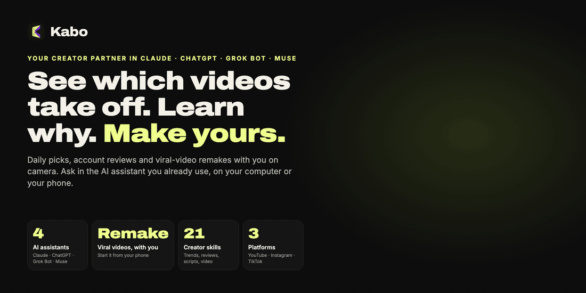
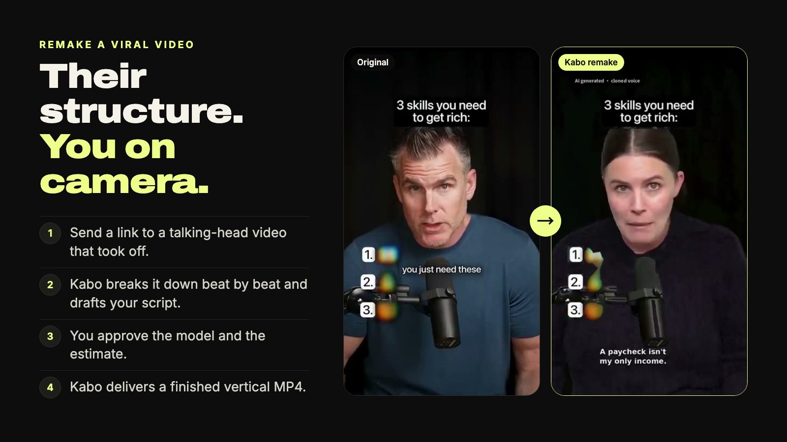
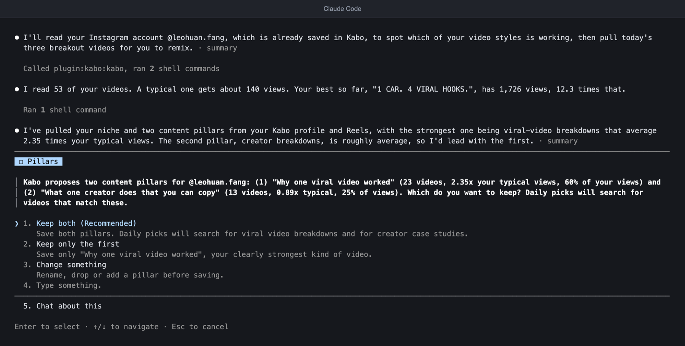
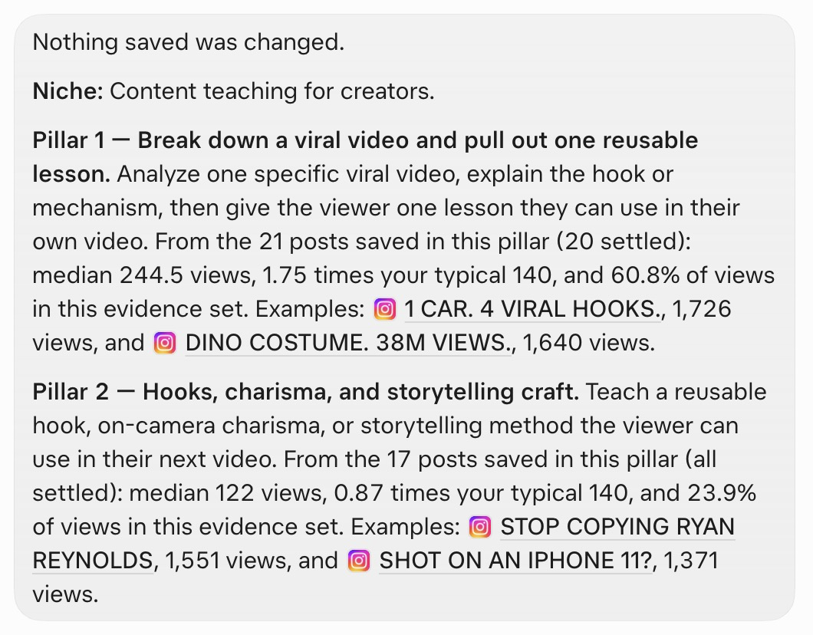
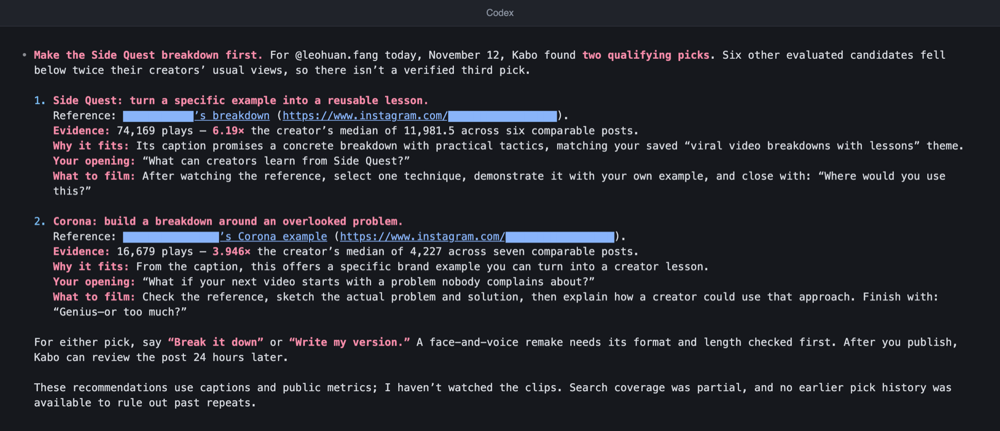
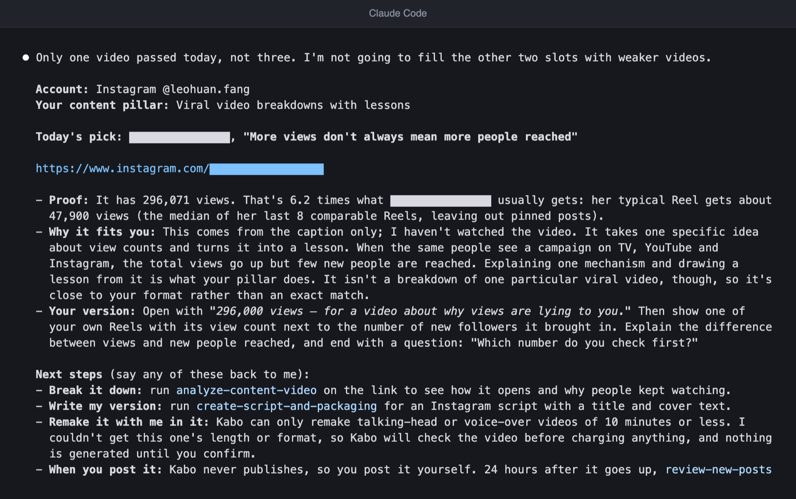
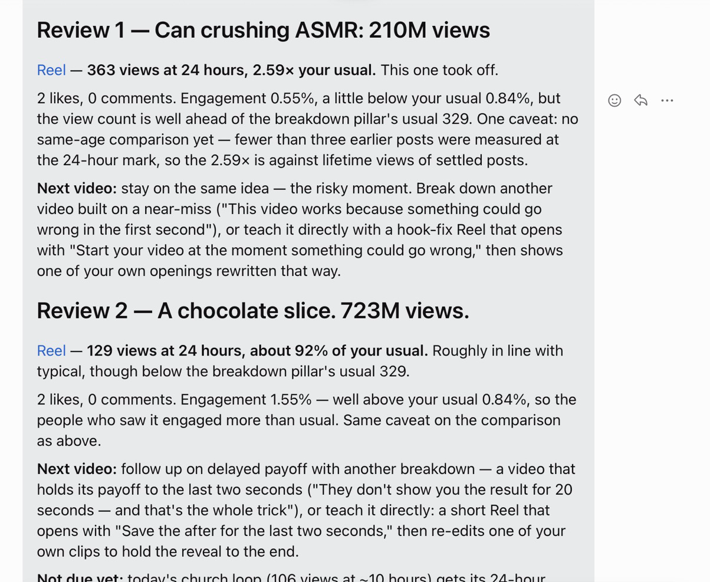
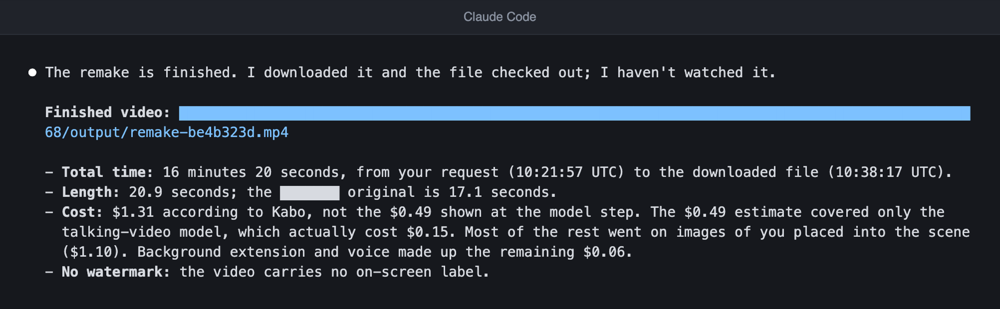

<h1 align="center">Kabo: your creator partner inside Claude, ChatGPT, Grok Bot and Muse</h1>

> ✨ **AI video generation is free for a limited time.** Remake a viral video with you on camera, at no charge while the offer lasts. [See videos made with Kabo](https://kabo.sh/?utm_source=github&utm_medium=referral&utm_campaign=202611_mcp_plugin_readme&utm_content=readme_promo).

<p align="center">
  <a href="https://kabo.sh/?utm_source=github&utm_medium=referral&utm_campaign=202611_mcp_plugin_readme&utm_content=readme_hero">
    
  </a>
</p>

<p align="center">
  <a href="https://kabo.sh/?utm_source=github&utm_medium=referral&utm_campaign=202611_mcp_plugin_readme&utm_content=readme_links_website">Website</a> ·
  <a href="#install">Install</a> ·
  <a href="https://kabo.sh/docs/mcp?utm_source=github&utm_medium=referral&utm_campaign=202611_mcp_plugin_readme&utm_content=readme_links_docs">Docs</a> ·
  <a href="https://kabo.sh/pricing?utm_source=github&utm_medium=referral&utm_campaign=202611_mcp_plugin_readme&utm_content=readme_links_pricing">Pricing</a> ·
  <a href="https://kabo.sh/tools?utm_source=github&utm_medium=referral&utm_campaign=202611_mcp_plugin_readme&utm_content=readme_links_tools">Free creator tools</a> ·
  <a href="https://github.com/kabo-sh/kabo-mcp-plugin/issues">Report an issue</a>
</p>

<p align="center">
  <a href="https://github.com/kabo-sh/kabo-mcp-plugin/releases/latest"></a>
  <a href="LICENSE"></a>
  <a href="#install"></a>
  <a href="#what-you-can-do"></a>
  <a href="#install"></a>
</p>

<p align="center">
  <a href="https://kabo.sh/integrations/claude-code?utm_source=github&utm_medium=referral&utm_campaign=202611_mcp_plugin_readme&utm_content=readme_add_claude"></a>
  <a href="https://chatgpt.com/plugins/plugin_asdk_app_6adac6e43f4481918fceac5ade2df2c6"></a>
  <a href="#install"></a>
  <a href="https://kabo.sh/integrations/muse?utm_source=github&utm_medium=referral&utm_campaign=202611_mcp_plugin_readme&utm_content=readme_add_muse"></a>
  <a href="https://kabo.sh/integrations/mcp?utm_source=github&utm_medium=referral&utm_campaign=202611_mcp_plugin_readme&utm_content=readme_add_mcp"></a>
</p>

<p align="center"><b>English</b> · <a href="docs/i18n/README.zh-CN.md">简体中文</a> · <a href="docs/i18n/README.es.md">Español</a> · <a href="docs/i18n/README.pt-BR.md">Português</a></p>

Kabo is an AI partner for YouTube, Instagram and TikTok creators. This repository is the Kabo plugin:
one connection to Kabo and twenty-one creator Skills that run inside the AI assistant you already use.
Two things set it apart:

- **One Kabo, four assistants.** The same account, the same saved profile and the same Skills work in
  Claude, ChatGPT, Grok Bot and Muse (and in Claude Code and Codex). Set up once, ask anywhere.
- **Remake a viral video with you on camera, from your phone.** Send a link to a talking-head video
  that took off. Kabo breaks it down, drafts your script, and delivers a finished vertical MP4. The
  video is made on Kabo's servers, so you can start it from an assistant's mobile app and come back
  for the result.

New Kabo accounts get 100 daily credits for their first 7 days. Details are on the [pricing page](https://kabo.sh/pricing?utm_source=github&utm_medium=referral&utm_campaign=202611_mcp_plugin_readme&utm_content=readme_free).

**Install in one message.** Paste this to your assistant:

```text
Install Kabo by following https://github.com/kabo-sh/kabo-mcp-plugin/blob/stable/INSTALL.md, then get me started.
```

> **Are you an AI assistant?** Read [INSTALL.md](INSTALL.md) to install Kabo for your user: it is the
> whole procedure. For a map of the product, read [kabo.sh/llms.txt](https://kabo.sh/llms.txt).

## See it in action

<p align="center">
  <a href="https://kabo.sh/?utm_source=github&utm_medium=referral&utm_campaign=202611_mcp_plugin_readme&utm_content=readme_remake">
    
  </a>
</p>

<p align="center"><sub>The original and its Kabo remake, from the pair shown on <a href="https://kabo.sh/?utm_source=github&utm_medium=referral&utm_campaign=202611_mcp_plugin_readme&utm_content=readme_remake_caption">kabo.sh</a>, where you can watch both videos in full.</sub></p>

A daily pick, as it reads in the chat:

```text
You   What should I make today?

Kabo  Scanned Instagram Reels from the last 7 days against your two confirmed pillars.
      11 of 18 candidates had public view counts.
      3 beat their own author's typical views by 2 times or more.

      1. "This video went viral years ago..."        2.3x the author's typical views
         Pillar: break down one viral video.
         Proof: 7-day median for that account, link attached.
         Your version: open on the result, then the one lesson you would reuse.

      2. "A hook so good it's unskippable"            2.4x
      3. "It went viral for the wrong reason"         2.4x

      Next: say "break down pick 1", "write my version", or "remake pick 1 with me in it".
      Kabo never posts for you. After you publish, ask for a review
      once the post is 24 hours old.
```

<sub>Condensed from a real session. Titles are shortened and account names removed; the multiples are the ones Kabo reported.</sub>

The same loop in four assistants, captured in November 2026:

<table>
  <tr>
    <td width="50%" valign="top">
      <br />
      <sub><b>First session</b> in Claude Code: Kabo reads the account and proposes content pillars to confirm.</sub>
    </td>
    <td width="50%" valign="top">
      <br />
      <sub><b>Pillars and their evidence</b> in Grok Bot.</sub>
    </td>
  </tr>
  <tr>
    <td width="50%" valign="top">
      <br />
      <sub><b>Daily picks</b> in Codex. Two videos cleared the 2x bar that day, so Kabo returned two and said why there was no third.</sub>
    </td>
    <td width="50%" valign="top">
      <br />
      <sub><b>Daily picks</b> in Claude Code on the same day: one pick, because Kabo does not pad the list with weaker videos.</sub>
    </td>
  </tr>
  <tr>
    <td width="50%" valign="top">
      <br />
      <sub><b>New-post review</b> in Muse: each post against the creator's own usual numbers, then the next video to make.</sub>
    </td>
    <td width="50%" valign="top">
      <br />
      <sub><b>Remake delivered</b> in Claude Code: a finished MP4 with the time, length and cost reported.</sub>
    </td>
  </tr>
</table>

<sub>Real sessions on a small test account, November 2026. Claude Code and Codex are terminal output rendered as images; Grok Bot and Muse are app screenshots. Other creators' handles and links are masked.</sub>

## Without Kabo, with Kabo

**Without Kabo**

- ❌ You scroll for an hour to guess what is working in your niche this week.
- ❌ You ask a chatbot for ideas and get generic ones, with no numbers and no sources.
- ❌ You find a video worth copying, then lose a day scripting, filming and editing your version.

**With Kabo**

- ✅ Three picks every morning, matched to your own content pillars, each measured against its author's typical views.
- ✅ Every finding carries its source links, time window and sample size, and says what could not be measured.
- ✅ Send the link and get a finished remake with you on camera, from the assistant you already use.

## The daily loop

Kabo is built to be used every day, not once.

| When | What you say | What Kabo does |
| --- | --- | --- |
| **First session** | "Get me started" | Explains what it can do, links one public Instagram, TikTok or YouTube account, reads your recent posts, and proposes your niche and two to four content pillars for you to confirm. |
| **Every morning** | "What should I make today?" | Picks three short videos from the last 7 days that match your pillars and beat their own author's typical views by at least 2 times. Each comes with proof, how to adapt it and next steps. Picks never repeat across days. |
| **Every evening** | "Review my new posts" | Reviews each post that has passed 24 hours against your own earlier posts at the same age, then recaps the account: follower change, the last 7 days against your typical views, each pillar, and one recommendation. |

Both daily jobs are safe to run unattended, so you can put them on your assistant's schedule and read
the results when they arrive.

## What you can do

| Job | What Kabo does | Skills |
| --- | --- | --- |
| **Start and keep a daily rhythm** | First-session setup, three picks a day, a review of every new post | `start-with-kabo` · `pick-daily-viral-videos` · `review-new-posts` |
| **Make the video** | Remakes a viral talking-head or voice-over video of up to 10 minutes with you in it, makes one from an approved script, or changes a delivered one | `remake-viral-video` |
| **Spot what is working now** | Current trends and the patterns behind high performers, measured against each account's own baseline | `research-youtube-trends` · `research-instagram-trends` · `research-tiktok-trends` |
| **Study competitors** | Finds comparable accounts, compares their recent content and names positioning gaps | `analyze-creator-competitors` · `analyze-tiktok-competitors` |
| **Review an account** | What works, what hurts, and what to continue, stop or test. The deep review also watches the videos. Diagnoses a reach drop | `review-creator-account` · `review-creator-account-deep` · `diagnose-reach-drop` |
| **Break down a video** | A timestamped read of the hook, pacing and structure of a public video or a local file | `analyze-content-video` |
| **Decide what to make next** | Content ideas from your account, trends and competitors, then the script, hook and title for the one you pick | `develop-content-ideas` · `create-script-and-packaging` |
| **Plan when to post** | A content calendar and posting times drawn from your own history | `plan-content-calendar` · `recommend-publish-timing` |
| **Build the brand and get paid** | Names, bios and a media kit; monetization thresholds; line-item pricing for a brand-deal brief | `optimize-creator-brand` · `plan-platform-monetization` · `price-creator-brand-deals` |
| **Check a platform rule** | Verifies a rule, threshold or rumour against official help pages, with quotes and dates | `verify-platform-rule` |

Ask in plain language. You do not need to name a Skill.

```text
Get me started with Kabo.
What should I make today?
Remake this video with me in it: <link to a talking-head video>
Why is @handle growing so fast on Instagram?
Break down the hook of this Reel: <link>
My TikTok reach dropped this month. What changed?
Plan my next four weeks of posts.
What should I charge for this sponsorship brief? <paste the brief>
```

<a id="installation-and-authentication"></a>

## Install

The fastest way is the same on every assistant. Paste this message and follow the sign-in prompt:

```text
Install Kabo by following https://github.com/kabo-sh/kabo-mcp-plugin/blob/stable/INSTALL.md, then get me started.
```

[INSTALL.md](INSTALL.md) is written for the assistant: it tells it how to add the Kabo connection, load
the Skills and check that everything works. Sign-in happens in your browser. There is no API key to copy.

**Using Claude Code or Codex on your computer?** One command installs the plugin for whichever of
the two it finds, then tells you the sign-in steps that are left:

```sh
npx kabo-sh install
```

Add `--dry-run` to see what it would run without changing anything. Grok Bot and Muse use the message
above instead.

| Assistant | Status | Install by hand |
| --- | :---: | --- |
| **Claude** (Claude Code 2.1.275 or later) | ✅ Supported | `claude plugin marketplace add kabo-sh/kabo-mcp-plugin`, then `claude plugin install kabo@kabo-mcp-plugin`. Run `/mcp` and sign in to Kabo. |
| **ChatGPT and Codex** (Codex 0.163 or later) | ✅ Supported | Open Plugins, find Kabo and add it. From a terminal: `codex plugin marketplace add kabo-sh/kabo-mcp-plugin`, then `codex plugin add kabo@kabo-plugin-openai`. |
| **Grok Bot** | ✅ Supported | Paste the message above into the Bot. It adds Kabo as an app and loads the Skills on the Bot's computer. |
| **Muse** | ✅ Supported | Paste the message above. Muse adds Kabo as a custom connector and loads the Skills on its computer. |
| **Cursor and other MCP clients** | Not yet tested | Add `https://kabo.sh/mcp-pub` as a remote MCP server with OAuth, then add the Skills. |

You need a Kabo account; signing in with Google creates one. The workflows need Python 3 and a
workspace the assistant can read and write.

Step-by-step guides: [kabo.sh/install](https://kabo.sh/install?utm_source=github&utm_medium=referral&utm_campaign=202611_mcp_plugin_readme&utm_content=readme_install) ·
[MCP setup](https://kabo.sh/docs/mcp?utm_source=github&utm_medium=referral&utm_campaign=202611_mcp_plugin_readme&utm_content=readme_install_mcp) ·
[full installation reference](docs/installation.md#installation-and-authentication)

<a id="skills-only"></a>

### Already connected Kabo? Add the Skills only

The connection provides the data tools. The Skills add the workflows. If you connected
`https://kabo.sh/mcp-pub` yourself, add the Skills with one command and keep your connection:

```sh
npx skills add 'kabo-sh/kabo-mcp-plugin#stable' --skill '*'
```

Git and ZIP installs, pinning a version, updating and uninstalling are in the
[installation reference](docs/installation.md#skills-only).

## How it works

1. **You ask in plain language.** Your assistant picks the matching Skill.
2. **Kabo fetches public data on its servers.** There are no platform API keys to set up.
3. **Your assistant does the analysis and writes the report.** Findings come with source links, the
   time window, the sample size and what could not be measured.

What Kabo does not do:

- **It never publishes for you.** It researches, drafts and makes the video; posting stays with you.
- **It does not guess private metrics.** Click-through rate, retention, revenue and Insights are never
  inferred from public views or likes.
- **It does not promise virality.** When the evidence is thin, the report says so.

## How Kabo compares

We make Kabo, so read this as our view. Each vidIQ, TubeBuddy and Viewstats cell comes from that product's
own pages ([vidiq.com/mcp](https://vidiq.com/mcp/), [vidiq.com/pricing](https://vidiq.com/pricing/), [tubebuddy.com/pricing](https://www.tubebuddy.com/pricing),
[viewstats.com](https://www.viewstats.com/)), checked in November 2026. If something has changed,
please [open an issue](https://github.com/kabo-sh/kabo-mcp-plugin/issues).

| | Kabo | vidIQ | TubeBuddy | Viewstats |
| --- | --- | --- | --- | --- |
| Where you use it | Inside Claude, ChatGPT, Grok Bot and Muse, in the browser, and in iPhone and Android apps | Web app, browser extension and mobile apps, plus an MCP server for ChatGPT, Claude, Muse, Cursor, Grok, Codex and other clients | Chrome extension and mobile app for YouTube | Web app |
| Platforms | YouTube, Instagram and TikTok | YouTube first, with public Instagram research | YouTube | YouTube |
| Makes a finished video with you on camera | Yes: remakes a viral talking-head video into a finished MP4 | Its MCP tool list includes clips cut from long videos and AI thumbnails | No: video and thumbnail tools | No: thumbnail search and video ideas |
| Daily picks matched to your own content pillars | Yes, up to three a day | Daily Ideas for your YouTube channel | Next Video Ideas | Outliers tool with filters |
| YouTube keyword scores | No dedicated keyword score | Yes | Yes: Keyword Explorer | Not listed |
| Changes your channel | Never: it does not publish or edit | With your approval it updates titles, descriptions, tags and thumbnails, replies to comments and publishes Instagram Reels | Bulk editing and scheduled publishing | Not listed |
| Free to start | 100 daily credits for a new account's first 7 days; AI video generation free for a limited time | Free plan with 150 AI credits a month | See its pricing page | Free account; Pro is paid |

Pick vidIQ if YouTube keywords and your own channel's connected analytics are the center of the job.
Pick TubeBuddy for YouTube keywords and tools that edit your channel. Pick
Viewstats to browse YouTube outliers and thumbnails. Pick Kabo if you want one partner across YouTube,
Instagram and TikTok that works in the assistant you already use and can take an idea all the way to
a finished video. Longer comparisons: [kabo.sh/alternatives](https://kabo.sh/alternatives?utm_source=github&utm_medium=referral&utm_campaign=202611_mcp_plugin_readme&utm_content=readme_compare).

## Pricing

- **AI video generation is free for a limited time.**
- **Free to start.** New accounts get 100 daily credits for their first 7 days.
- **Plans.** Pro and Ultra add daily credits. Current prices are on the
  [pricing page](https://kabo.sh/pricing?utm_source=github&utm_medium=referral&utm_campaign=202611_mcp_plugin_readme&utm_content=readme_pricing).

Before a remake starts, Kabo shows the model choices and an estimate, and waits for your approval.

## Privacy

Creator research uses public data fetched by Kabo's servers. Signing in uses OAuth in your browser;
your assistant never sees a Kabo password. The plugin asks for read and write access to your Kabo
workspace so that it can link your account and save your pillars, scripts and preferences; see
[Your saved Kabo work](docs/workspace.md). [Privacy](https://kabo.sh/privacy) · [Terms](https://kabo.sh/terms)

## More from Kabo

- **[Kabo in the browser](https://kabo.sh/?utm_source=github&utm_medium=referral&utm_campaign=202611_mcp_plugin_readme&utm_content=readme_more_web)**: the full workspace, no setup.
- **Kabo for [iPhone](https://apps.apple.com/us/app/kabo-ai-creator-coach/id6800972386) and [Android](https://play.google.com/store/apps/details?id=com.dealism.kabo)**: pre-publish video feedback on the go.
- **[Free creator tools](https://kabo.sh/tools?utm_source=github&utm_medium=referral&utm_campaign=202611_mcp_plugin_readme&utm_content=readme_more_tools)**: calculators, checkers and generators. No account needed.

## What's new

New in November 2026:

- **The daily loop.** `start-with-kabo`, `pick-daily-viral-videos` and `review-new-posts` set you up once, then bring picks and post reviews every day.
- **Remake from your own files.** `remake-viral-video` now accepts videos and photos from your device as well as public links.
- **One-message install for any assistant.** [INSTALL.md](INSTALL.md) lets Grok Bot, Muse and other assistants install Kabo for you.

Every release is listed on the [releases page](https://github.com/kabo-sh/kabo-mcp-plugin/releases).

## FAQ

<details>
<summary><b>What is Kabo?</b></summary>

Kabo is an AI partner for creators. You ask in plain language; it researches public creator data,
explains what is working, and turns that evidence into videos you can make. This plugin brings Kabo
into the AI assistant you already use. Kabo also runs [in the browser](https://kabo.sh/?utm_source=github&utm_medium=referral&utm_campaign=202611_mcp_plugin_readme&utm_content=readme_faq_web).
</details>

<details>
<summary><b>Which assistants and platforms does it support?</b></summary>

Assistants: Claude (Claude Code), ChatGPT and Codex, Grok Bot and Muse. Other assistants that support
remote MCP servers with OAuth can connect too; see [Install](#install). Platforms: YouTube, Instagram
and TikTok.
</details>

<details>
<summary><b>Is it free?</b></summary>

AI video generation is free for a limited time. New accounts get 100 daily credits for their first
7 days. After that, see the [pricing page](https://kabo.sh/pricing?utm_source=github&utm_medium=referral&utm_campaign=202611_mcp_plugin_readme&utm_content=readme_faq_pricing). The
plugin itself is open source under the MIT license.
</details>

<details>
<summary><b>Can I really remake a video from my phone?</b></summary>

Yes. The video is made on Kabo's servers, not on your device. Ask for the remake in your assistant's
mobile app, approve the model and the estimate, and come back for the finished MP4.
</details>

<details>
<summary><b>What does "evidence attached" mean?</b></summary>

Kabo keeps the source links, the comparison window and the timestamps behind a conclusion next to the
answer. When the evidence is thin, it says so instead of presenting a guess as fact. Its analysis
cannot guarantee reach, views or growth.
</details>

<details>
<summary><b>Does Kabo post for me or change my account?</b></summary>

No. Kabo researches, drafts and makes the video. Publishing stays with you, and Kabo works from public
data: it does not read your private analytics.
</details>

## For maintainers

- [Installation reference](docs/installation.md): current release, Skills-only installs, per-host details, requirements, updating, uninstalling and rollback.
- [Development and release](docs/development.md): repository layout, checks, building the package, acceptance.
- [Your saved Kabo work](docs/workspace.md): what the plugin reads and writes in a Kabo workspace.
- [Skills specification](docs/skills-spec.md) · [Changelog](CHANGELOG.md) · [Instructions for AI assistants](INSTALL.md)

## License

[MIT](LICENSE)
