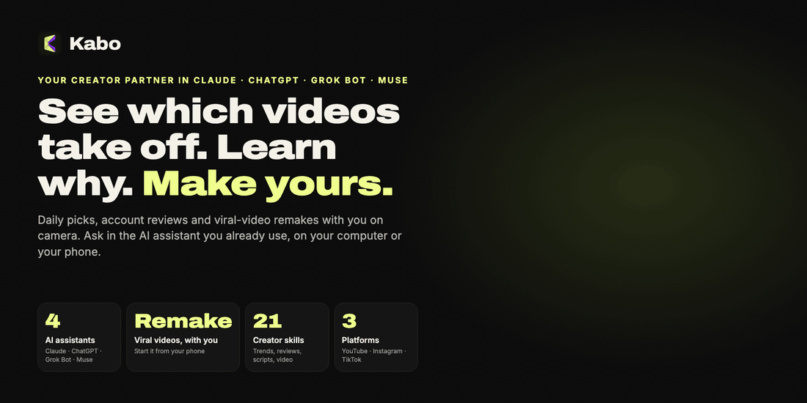
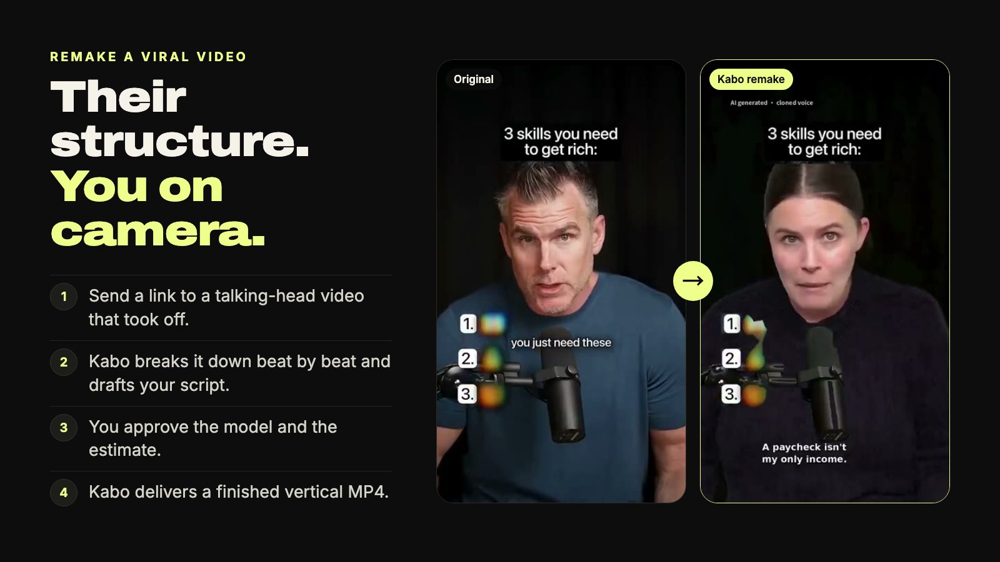
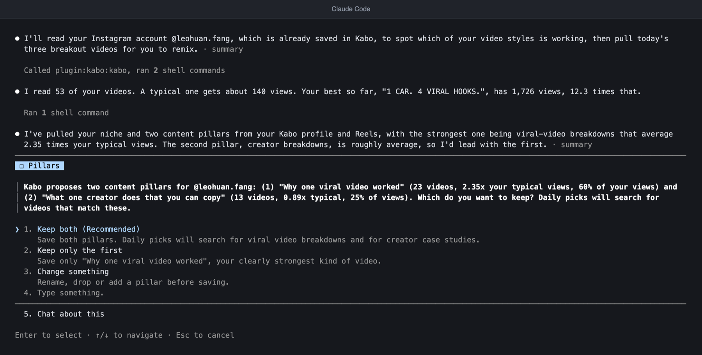
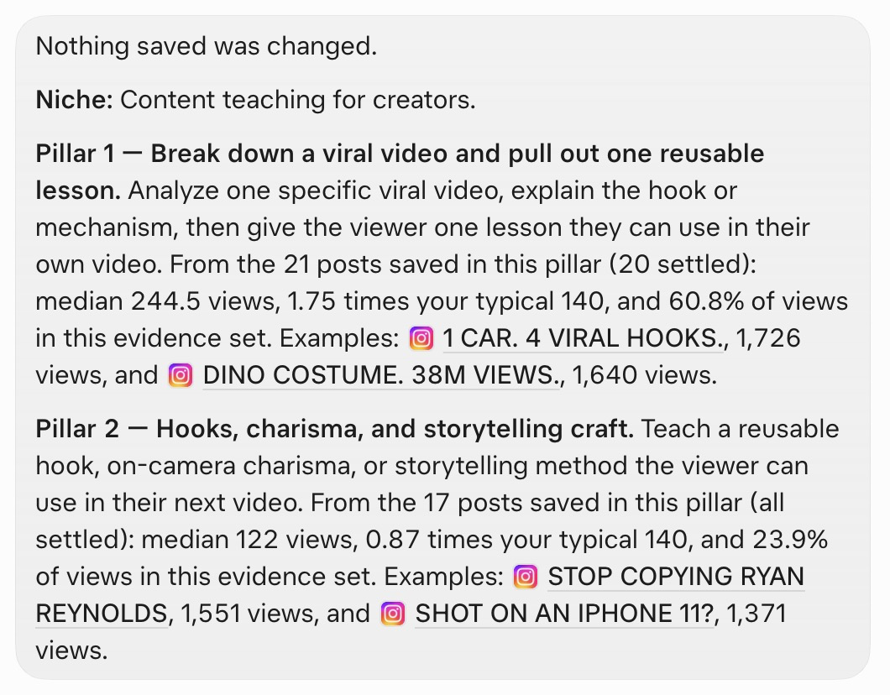
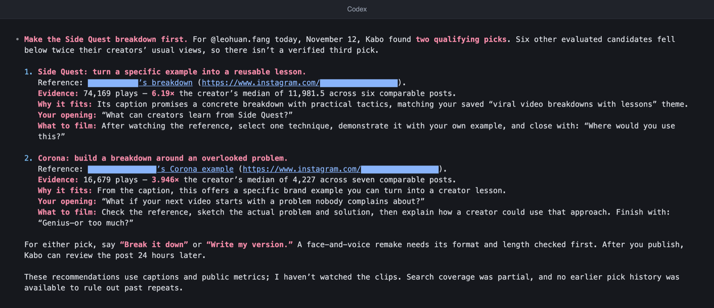
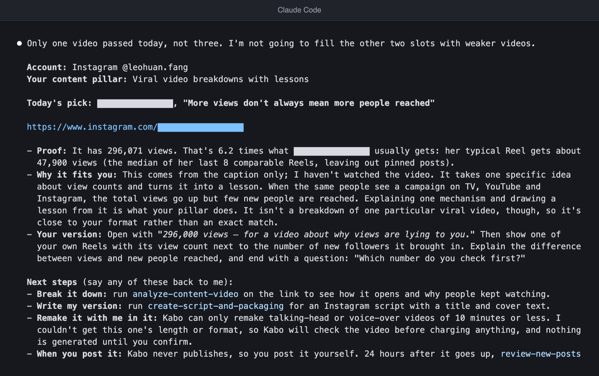
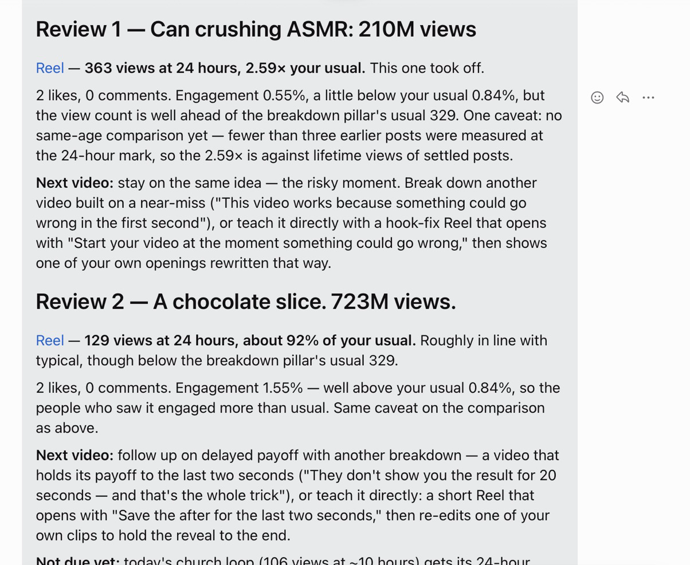
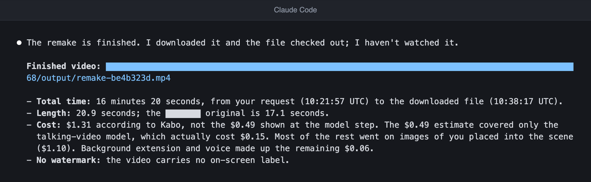

<h1 align="center">Kabo: tu socio creador dentro de Claude, ChatGPT, Grok Bot y Muse</h1>

> Esta página es una traducción del [README en inglés](../../README.md). Si hay diferencias, vale la versión en inglés.

> ✨ **La generación de video con IA es gratis por tiempo limitado.** Recrea un video viral contigo frente a la cámara, sin costo mientras dure la oferta. [Mira videos hechos con Kabo](https://kabo.sh/?utm_source=github&utm_medium=referral&utm_campaign=202611_mcp_plugin_readme&utm_content=readme_promo).

<p align="center">
  <a href="https://kabo.sh/?utm_source=github&utm_medium=referral&utm_campaign=202611_mcp_plugin_readme&utm_content=readme_hero">
    
  </a>
</p>

<p align="center">
  <a href="https://kabo.sh/?utm_source=github&utm_medium=referral&utm_campaign=202611_mcp_plugin_readme&utm_content=readme_links_website">Sitio web</a> ·
  <a href="#install">Instalar</a> ·
  <a href="https://kabo.sh/docs/mcp?utm_source=github&utm_medium=referral&utm_campaign=202611_mcp_plugin_readme&utm_content=readme_links_docs">Documentación</a> ·
  <a href="https://kabo.sh/pricing?utm_source=github&utm_medium=referral&utm_campaign=202611_mcp_plugin_readme&utm_content=readme_links_pricing">Precios</a> ·
  <a href="https://kabo.sh/tools?utm_source=github&utm_medium=referral&utm_campaign=202611_mcp_plugin_readme&utm_content=readme_links_tools">Herramientas gratis para creadores</a> ·
  <a href="https://github.com/kabo-sh/kabo-mcp-plugin/issues">Reportar un problema</a>
</p>

<p align="center">
  <a href="https://github.com/kabo-sh/kabo-mcp-plugin/releases/latest"></a>
  <a href="../../LICENSE"></a>
  <a href="#install"></a>
  <a href="#what-you-can-do"></a>
  <a href="#install"></a>
</p>

<p align="center">
  <a href="https://kabo.sh/integrations/claude-code?utm_source=github&utm_medium=referral&utm_campaign=202611_mcp_plugin_readme&utm_content=readme_add_claude"></a>
  <a href="https://chatgpt.com/plugins/plugin_asdk_app_6adac6e43f4481918fceac5ade2df2c6"></a>
  <a href="#install"></a>
  <a href="https://kabo.sh/integrations/muse?utm_source=github&utm_medium=referral&utm_campaign=202611_mcp_plugin_readme&utm_content=readme_add_muse"></a>
  <a href="https://kabo.sh/integrations/mcp?utm_source=github&utm_medium=referral&utm_campaign=202611_mcp_plugin_readme&utm_content=readme_add_mcp"></a>
</p>

<p align="center"><a href="../../README.md">English</a> · <a href="README.zh-CN.md">简体中文</a> · <b>Español</b> · <a href="README.pt-BR.md">Português</a></p>

Kabo es un socio de IA para creadores de YouTube, Instagram y TikTok. Este repositorio es el plugin de Kabo:
una sola conexión a Kabo y veintidós Skills para creadores que funcionan dentro del asistente de IA que ya usas.
Hay dos cosas que lo distinguen:

- **Un solo Kabo, cuatro asistentes.** La misma cuenta, el mismo perfil guardado y los mismos Skills funcionan en
  Claude, ChatGPT, Grok Bot y Muse (y en Claude Code y Codex). Lo configuras una vez y preguntas donde quieras.
- **Recrea un video viral contigo frente a la cámara, desde tu teléfono.** Envía el enlace de un video
  de una persona hablando a cámara que se hizo viral. Kabo lo desglosa, redacta tu guion y te entrega un MP4
  vertical terminado. El video se hace en los servidores de Kabo, así que puedes iniciarlo desde la app móvil
  de un asistente y volver después por el resultado.

Las cuentas nuevas de Kabo reciben 100 créditos diarios durante sus primeros 7 días. Los detalles están en la [página de precios](https://kabo.sh/pricing?utm_source=github&utm_medium=referral&utm_campaign=202611_mcp_plugin_readme&utm_content=readme_free).

**Instálalo con un solo mensaje.** Pega esto en tu asistente (el mensaje debe quedar en inglés, tal cual, porque el asistente lo recibe así):

```text
Install Kabo by following https://github.com/kabo-sh/kabo-mcp-plugin/blob/stable/INSTALL.md, then get me started.
```

> **¿Eres un asistente de IA?** Lee [INSTALL.md](../../INSTALL.md) para instalar Kabo a tu usuario: ahí está
> todo el procedimiento. Para un mapa del producto, lee [kabo.sh/llms.txt](https://kabo.sh/llms.txt).

## Míralo en acción

<p align="center">
  <a href="https://kabo.sh/?utm_source=github&utm_medium=referral&utm_campaign=202611_mcp_plugin_readme&utm_content=readme_remake">
    
  </a>
</p>

<p align="center"><sub>El original y su remake de Kabo, del par que se muestra en <a href="https://kabo.sh/?utm_source=github&utm_medium=referral&utm_campaign=202611_mcp_plugin_readme&utm_content=readme_remake_caption">kabo.sh</a>, donde puedes ver ambos videos completos.</sub></p>

Una selección diaria, tal como se ve en el chat:

```text
Tú    ¿Qué debería hacer hoy?

Kabo  Revisé los Reels de Instagram de los últimos 7 días frente a tus dos pilares confirmados.
      11 de 18 candidatos tenían número de vistas público.
      3 superaron 2 veces o más las vistas habituales de su propio autor.

      1. "Este video se hizo viral hace años..."      2.3x las vistas habituales del autor
         Pilar: desglosar un video viral.
         Prueba: mediana de 7 días de esa cuenta, enlace adjunto.
         Tu versión: abre con el resultado y luego la única lección que reutilizarías.

      2. "Un gancho tan bueno que no puedes saltarlo"  2.4x
      3. "Se hizo viral por la razón equivocada"       2.4x

      Siguiente: di "desglosa la selección 1", "escribe mi versión" o "recrea la selección 1 conmigo".
      Kabo nunca publica por ti. Después de publicar, pídeme una revisión
      cuando la publicación cumpla 24 horas.
```

<sub>Condensado de una sesión real. Los títulos están acortados y se quitaron los nombres de las cuentas; los múltiplos son los que Kabo reportó.</sub>

El mismo ciclo en cuatro asistentes, capturado en noviembre de 2026:

<table>
  <tr>
    <td width="50%" valign="top">
      <br />
      <sub><b>Primera sesión</b> en Claude Code: Kabo lee la cuenta y propone pilares de contenido para que los confirmes.</sub>
    </td>
    <td width="50%" valign="top">
      <br />
      <sub><b>Pilares y su evidencia</b> en Grok Bot.</sub>
    </td>
  </tr>
  <tr>
    <td width="50%" valign="top">
      <br />
      <sub><b>Selecciones diarias</b> en Codex. Ese día dos videos superaron el umbral de 2 veces, así que Kabo devolvió dos y explicó por qué no hubo un tercero.</sub>
    </td>
    <td width="50%" valign="top">
      <br />
      <sub><b>Selecciones diarias</b> en Claude Code el mismo día: una sola, porque Kabo no rellena la lista con videos más débiles.</sub>
    </td>
  </tr>
  <tr>
    <td width="50%" valign="top">
      <br />
      <sub><b>Revisión de publicaciones nuevas</b> en Muse: cada publicación frente a los números habituales del propio creador, y luego el siguiente video.</sub>
    </td>
    <td width="50%" valign="top">
      <br />
      <sub><b>Remake entregado</b> en Claude Code: un MP4 terminado, con el tiempo, la duración y el costo informados.</sub>
    </td>
  </tr>
</table>

<sub>Sesiones reales en una cuenta de prueba pequeña, noviembre de 2026; la interfaz y las respuestas están en inglés. Claude Code y Codex son salida de terminal convertida en imagen; Grok Bot y Muse son capturas de la app. Los nombres de usuario y enlaces de otros creadores están ocultos.</sub>

## Sin Kabo, con Kabo

**Sin Kabo**

- ❌ Te pasas una hora haciendo scroll para adivinar qué está funcionando esta semana en tu nicho.
- ❌ Le pides ideas a un chatbot y obtienes ideas genéricas, sin números y sin fuentes.
- ❌ Encuentras un video que vale la pena copiar y pierdes un día escribiendo el guion, grabando y editando tu versión.

**Con Kabo**

- ✅ Tres selecciones cada mañana, acordes con tus propios pilares de contenido, cada una medida contra las vistas habituales de su autor.
- ✅ Cada hallazgo incluye sus enlaces de origen, la ventana de tiempo y el tamaño de la muestra, e indica lo que no se pudo medir.
- ✅ Envías el enlace y obtienes un remake terminado contigo frente a la cámara, desde el asistente que ya usas.

## El ciclo diario

Kabo está hecho para usarse todos los días, no una sola vez.

| Cuándo | Qué dices | Qué hace Kabo |
| --- | --- | --- |
| **Primera sesión** | "Ayúdame a empezar" | Explica lo que puede hacer, vincula una cuenta pública de Instagram, TikTok o YouTube, lee tus publicaciones recientes y te propone tu nicho y de dos a cuatro pilares de contenido para que los confirmes. |
| **Cada mañana** | "¿Qué debería hacer hoy?" | Elige tres videos cortos de los últimos 7 días que encajan con tus pilares y superan al menos 2 veces las vistas habituales de su propio autor. Cada uno viene con su prueba, cómo adaptarlo y los siguientes pasos. Las selecciones no se repiten de un día a otro. |
| **Cada tarde** | "Revisa mis publicaciones nuevas" | Revisa cada publicación que ya cumplió 24 horas frente a tus publicaciones anteriores a la misma edad, y luego hace un resumen de la cuenta: cambio de seguidores, los últimos 7 días frente a tus vistas habituales, cada pilar y una recomendación. |

Las dos tareas diarias se pueden ejecutar sin supervisión, así que puedes ponerlas en la programación de tu asistente
y leer los resultados cuando lleguen.

<a id="what-you-can-do"></a>

## Qué puedes hacer

| Tarea | Qué hace Kabo | Skills |
| --- | --- | --- |
| **Empezar y mantener un ritmo diario** | Configuración de la primera sesión, tres selecciones al día, una revisión de cada publicación nueva | `start-with-kabo` · `pick-daily-viral-videos` · `review-new-posts` |
| **Hacer el video** | Recrea un video viral de una persona hablando a cámara o con voz en off de hasta 10 minutos contigo en él, hace uno a partir de un guion aprobado o cambia uno ya entregado | `remake-viral-video` |
| **Detectar lo que funciona ahora** | Tendencias actuales y los patrones detrás de los videos de mejor desempeño, medidos contra la base de cada cuenta | `research-youtube-trends` · `research-instagram-trends` · `research-tiktok-trends` |
| **Estudiar a la competencia** | Encuentra cuentas comparables, compara su contenido reciente y señala los espacios de posicionamiento sin cubrir | `analyze-creator-competitors` · `analyze-tiktok-competitors` |
| **Revisar una cuenta** | Qué funciona, qué perjudica y qué continuar, detener o probar. La revisión profunda además mira los videos. Diagnostica una caída de alcance | `review-creator-account` · `review-creator-account-deep` · `diagnose-reach-drop` |
| **Desglosar un video** | Una lectura con marcas de tiempo del gancho, el ritmo y la estructura de un video público o de un archivo local | `analyze-content-video` |
| **Decidir qué hacer a continuación** | Ideas de contenido a partir de tu cuenta, las tendencias y la competencia, y luego el guion, el gancho y el título de la que elijas | `develop-content-ideas` · `create-script-and-packaging` |
| **Revisar miniaturas** | Diez comprobaciones de aprobado o suspenso sobre una a tres miniaturas subidas, con un motivo y un arreglo para cada una, los primeros cambios que hacer y qué candidata usar | `review-thumbnail` |
| **Planear cuándo publicar** | Un calendario de contenido y horarios de publicación basados en tu propio historial | `plan-content-calendar` · `recommend-publish-timing` |
| **Construir la marca y cobrar** | Nombres, biografías y un media kit; umbrales de monetización; precios por concepto para el brief de una marca | `optimize-creator-brand` · `plan-platform-monetization` · `price-creator-brand-deals` |
| **Comprobar una regla de plataforma** | Verifica una regla, un umbral o un rumor en las páginas de ayuda oficiales, con citas y fechas | `verify-platform-rule` |

Pregunta con lenguaje natural. No necesitas nombrar un Skill.

```text
Ayúdame a empezar con Kabo.
¿Qué debería hacer hoy?
Recrea este video conmigo en él: <enlace a un video de una persona hablando a cámara>
¿Por qué @handle está creciendo tan rápido en Instagram?
Desglosa el gancho de este Reel: <enlace>
Mi alcance en TikTok bajó este mes. ¿Qué cambió?
Planea mis próximas cuatro semanas de publicaciones.
¿Cuánto debería cobrar por este brief de patrocinio? <pega el brief>
```

<a id="install"></a>

<a id="installation-and-authentication"></a>

## Instalar

La forma más rápida es la misma en todos los asistentes. Pega este mensaje y sigue la indicación para iniciar sesión (deja el mensaje en inglés, tal cual):

```text
Install Kabo by following https://github.com/kabo-sh/kabo-mcp-plugin/blob/stable/INSTALL.md, then get me started.
```

[INSTALL.md](../../INSTALL.md) está escrito para el asistente: le dice cómo agregar la conexión de Kabo, cargar
los Skills y comprobar que todo funcione. El inicio de sesión se hace en tu navegador. No hay ninguna clave de API que copiar.

**¿Usas Claude Code o Codex en tu computadora?** Un solo comando instala el plugin en el que encuentre
de los dos y luego te indica los pasos de inicio de sesión que faltan:

```sh
npx kabo-sh install
```

Agrega `--dry-run` para ver qué ejecutaría sin cambiar nada. Grok Bot y Muse siguen usando el mensaje
de arriba.

| Asistente | Estado | Instalación manual |
| --- | :---: | --- |
| **Claude** (Claude Code 2.1.275 o posterior) | ✅ Compatible | `claude plugin marketplace add kabo-sh/kabo-mcp-plugin`, luego `claude plugin install kabo@kabo-mcp-plugin`. Ejecuta `/mcp` e inicia sesión en Kabo. |
| **ChatGPT y Codex** (Codex 0.163 o posterior) | ✅ Compatible | Abre Plugins, busca Kabo y agrégalo. Desde una terminal: `codex plugin marketplace add kabo-sh/kabo-mcp-plugin`, luego `codex plugin add kabo@kabo-plugin-openai`. |
| **Grok Bot** | ✅ Compatible | Pega el mensaje de arriba en el Bot. Agrega Kabo como app y carga los Skills en la computadora del Bot. |
| **Muse** | ✅ Compatible | Pega el mensaje de arriba. Muse agrega Kabo como conector personalizado y carga los Skills en su computadora. |
| **Cursor y otros clientes MCP** | Aún sin probar | Agrega `https://kabo.sh/mcp-pub` como servidor MCP remoto con OAuth y luego agrega los Skills. |

Necesitas una cuenta de Kabo; iniciar sesión con Google crea una. Los flujos de trabajo necesitan Python 3 y un
espacio de trabajo que el asistente pueda leer y escribir.

Guías paso a paso: [kabo.sh/install](https://kabo.sh/install?utm_source=github&utm_medium=referral&utm_campaign=202611_mcp_plugin_readme&utm_content=readme_install) ·
[Configuración de MCP](https://kabo.sh/docs/mcp?utm_source=github&utm_medium=referral&utm_campaign=202611_mcp_plugin_readme&utm_content=readme_install_mcp) ·
[referencia completa de instalación](../installation.md#installation-and-authentication)

<a id="skills-only"></a>

### ¿Ya conectaste Kabo? Agrega solo los Skills

La conexión ofrece las herramientas de datos. Los Skills agregan los flujos de trabajo. Si conectaste
`https://kabo.sh/mcp-pub` por tu cuenta, agrega los Skills con un solo comando y conserva tu conexión:

```sh
npx skills add 'kabo-sh/kabo-mcp-plugin#stable' --skill '*'
```

Las instalaciones con Git y ZIP, cómo fijar una versión, actualizar y desinstalar están en la
[referencia de instalación](../installation.md#skills-only).

## Cómo funciona

1. **Preguntas con lenguaje natural.** Tu asistente elige el Skill que corresponde.
2. **Kabo obtiene datos públicos en sus servidores.** No hay claves de API de plataformas que configurar.
3. **Tu asistente hace el análisis y escribe el informe.** Los hallazgos vienen con enlaces de origen, la
   ventana de tiempo, el tamaño de la muestra y lo que no se pudo medir.

Lo que Kabo no hace:

- **Nunca publica por ti.** Investiga, redacta y hace el video; publicar queda de tu parte.
- **No adivina métricas privadas.** La tasa de clics, la retención, los ingresos y las estadísticas internas (Insights) nunca se
  deducen a partir de vistas o me gusta públicos.
- **No promete viralidad.** Cuando la evidencia es escasa, el informe lo dice.

## Cómo se compara Kabo

Nosotros hacemos Kabo, así que lee esto como nuestra opinión. Cada celda de vidIQ, TubeBuddy y Viewstats proviene de las
páginas del propio producto ([vidiq.com/mcp](https://vidiq.com/mcp/), [vidiq.com/pricing](https://vidiq.com/pricing/), [tubebuddy.com/pricing](https://www.tubebuddy.com/pricing),
[viewstats.com](https://www.viewstats.com/)), revisadas en noviembre de 2026. Si algo cambió,
por favor [abre un issue](https://github.com/kabo-sh/kabo-mcp-plugin/issues).

| | Kabo | vidIQ | TubeBuddy | Viewstats |
| --- | --- | --- | --- | --- |
| Dónde lo usas | Dentro de Claude, ChatGPT, Grok Bot y Muse, en el navegador y en apps para iPhone y Android | App web, extensión de navegador y apps móviles, más un servidor MCP para ChatGPT, Claude, Muse, Cursor, Grok, Codex y otros clientes | Extensión de Chrome y app móvil para YouTube | App web |
| Plataformas | YouTube, Instagram y TikTok | YouTube primero, con investigación pública de Instagram | YouTube | YouTube |
| Hace un video terminado contigo frente a la cámara | Sí: convierte un video viral de una persona hablando a cámara en un MP4 terminado | Su lista de herramientas MCP incluye clips recortados de videos largos y miniaturas con IA | No: herramientas de video y miniaturas | No: búsqueda de miniaturas e ideas de video |
| Selecciones diarias acordes con tus propios pilares de contenido | Sí, hasta tres al día | Daily Ideas para tu canal de YouTube | Next Video Ideas | Herramienta Outliers con filtros |
| Puntuaciones de palabras clave de YouTube | Sin puntuación de palabras clave dedicada | Sí | Sí: Keyword Explorer | No figura |
| Cambia tu canal | Nunca: no publica ni edita | Con tu aprobación actualiza títulos, descripciones, etiquetas y miniaturas, responde comentarios y publica Reels de Instagram | Edición masiva y publicación programada | No figura |
| Gratis para empezar | 100 créditos diarios durante los primeros 7 días de una cuenta nueva; generación de video con IA gratis por tiempo limitado | Plan gratuito con 150 créditos de IA al mes | Consulta su página de precios | Cuenta gratuita; Pro es de pago |

Elige vidIQ si las palabras clave de YouTube y las analíticas conectadas de tu propio canal son el centro del trabajo.
Elige TubeBuddy para palabras clave de YouTube y herramientas que editan tu canal. Elige
Viewstats para explorar videos atípicos (outliers) y miniaturas de YouTube. Elige Kabo si quieres un solo socio para YouTube,
Instagram y TikTok que funcione en el asistente que ya usas y pueda llevar una idea hasta
un video terminado. Comparaciones más largas: [kabo.sh/alternatives](https://kabo.sh/alternatives?utm_source=github&utm_medium=referral&utm_campaign=202611_mcp_plugin_readme&utm_content=readme_compare).

## Precios

- **La generación de video con IA es gratis por tiempo limitado.**
- **Gratis para empezar.** Las cuentas nuevas reciben 100 créditos diarios durante sus primeros 7 días.
- **Planes.** Pro y Ultra agregan créditos diarios. Los precios actuales están en la
  [página de precios](https://kabo.sh/pricing?utm_source=github&utm_medium=referral&utm_campaign=202611_mcp_plugin_readme&utm_content=readme_pricing).

Antes de que empiece un remake, Kabo muestra las opciones de modelo y una estimación, y espera tu aprobación.

## Privacidad

La investigación de creadores usa datos públicos que obtienen los servidores de Kabo. El inicio de sesión usa OAuth en tu navegador;
tu asistente nunca ve una contraseña de Kabo. El plugin pide acceso de lectura y escritura a tu espacio de trabajo
de Kabo para poder vincular tu cuenta y guardar tus pilares, guiones y preferencias; consulta
[Tu trabajo guardado en Kabo](../workspace.md). [Privacidad](https://kabo.sh/privacy) · [Términos](https://kabo.sh/terms)

## Más de Kabo

- **[Kabo en el navegador](https://kabo.sh/?utm_source=github&utm_medium=referral&utm_campaign=202611_mcp_plugin_readme&utm_content=readme_more_web)**: el espacio de trabajo completo, sin configuración.
- **Kabo para [iPhone](https://apps.apple.com/us/app/kabo-ai-creator-coach/id6800972386) y [Android](https://play.google.com/store/apps/details?id=com.dealism.kabo)**: comentarios sobre tus videos antes de publicar, estés donde estés.
- **[Herramientas gratis para creadores](https://kabo.sh/tools?utm_source=github&utm_medium=referral&utm_campaign=202611_mcp_plugin_readme&utm_content=readme_more_tools)**: calculadoras, verificadores y generadores. No necesitas cuenta.

## Novedades

Novedades de noviembre de 2026:

- **El ciclo diario.** `start-with-kabo`, `pick-daily-viral-videos` y `review-new-posts` te configuran una sola vez y luego te traen selecciones y revisiones de publicaciones todos los días.
- **Remake a partir de tus propios archivos.** `remake-viral-video` ahora acepta videos y fotos de tu dispositivo, además de enlaces públicos.
- **Instalación con un solo mensaje para cualquier asistente.** [INSTALL.md](../../INSTALL.md) permite que Grok Bot, Muse y otros asistentes instalen Kabo por ti.

Cada versión está listada en la [página de releases](https://github.com/kabo-sh/kabo-mcp-plugin/releases).

## Preguntas frecuentes

<details>
<summary><b>¿Qué es Kabo?</b></summary>

Kabo es un socio de IA para creadores. Preguntas con lenguaje natural; investiga datos públicos de creadores,
explica qué está funcionando y convierte esa evidencia en videos que puedes hacer. Este plugin lleva Kabo
al asistente de IA que ya usas. Kabo también funciona [en el navegador](https://kabo.sh/?utm_source=github&utm_medium=referral&utm_campaign=202611_mcp_plugin_readme&utm_content=readme_faq_web).
</details>

<details>
<summary><b>¿Qué asistentes y plataformas admite?</b></summary>

Asistentes: Claude (Claude Code), ChatGPT y Codex, Grok Bot y Muse. Otros asistentes que admitan
servidores MCP remotos con OAuth también pueden conectarse; consulta [Instalar](#install). Plataformas: YouTube, Instagram
y TikTok.
</details>

<details>
<summary><b>¿Es gratis?</b></summary>

La generación de video con IA es gratis por tiempo limitado. Las cuentas nuevas reciben 100 créditos diarios durante sus primeros
7 días. Después, consulta la [página de precios](https://kabo.sh/pricing?utm_source=github&utm_medium=referral&utm_campaign=202611_mcp_plugin_readme&utm_content=readme_faq_pricing). El
plugin en sí es de código abierto bajo la licencia MIT.
</details>

<details>
<summary><b>¿De verdad puedo hacer un remake de un video desde mi teléfono?</b></summary>

Sí. El video se hace en los servidores de Kabo, no en tu dispositivo. Pide el remake en la app móvil
de tu asistente, aprueba el modelo y la estimación, y vuelve por el MP4 terminado.
</details>

<details>
<summary><b>¿Qué significa "evidencia adjunta"?</b></summary>

Kabo conserva junto a la respuesta los enlaces de origen, la ventana de comparación y las marcas de tiempo que respaldan una
conclusión. Cuando la evidencia es escasa, lo dice en lugar de presentar una suposición como un hecho. Su análisis
no puede garantizar alcance, vistas ni crecimiento.
</details>

<details>
<summary><b>¿Kabo publica por mí o cambia mi cuenta?</b></summary>

No. Kabo investiga, redacta y hace el video. Publicar queda de tu parte, y Kabo trabaja con datos
públicos: no lee tus analíticas privadas.
</details>

## Para mantenedores

- [Referencia de instalación](../installation.md): versión actual, instalaciones solo de Skills, detalles por asistente, requisitos, actualización, desinstalación y reversión.
- [Desarrollo y publicación de versiones](../development.md): estructura del repositorio, verificaciones, construcción del paquete, aceptación.
- [Tu trabajo guardado en Kabo](../workspace.md): qué lee y escribe el plugin en un espacio de trabajo de Kabo.
- [Especificación de Skills](../skills-spec.md) · [Changelog](../../CHANGELOG.md) · [Instrucciones para asistentes de IA](../../INSTALL.md)

## Licencia

[MIT](../../LICENSE)
