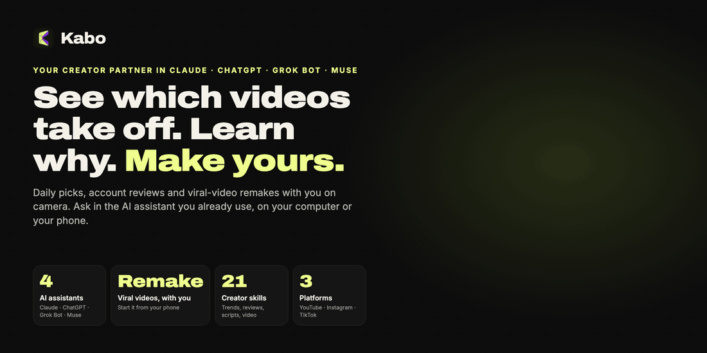
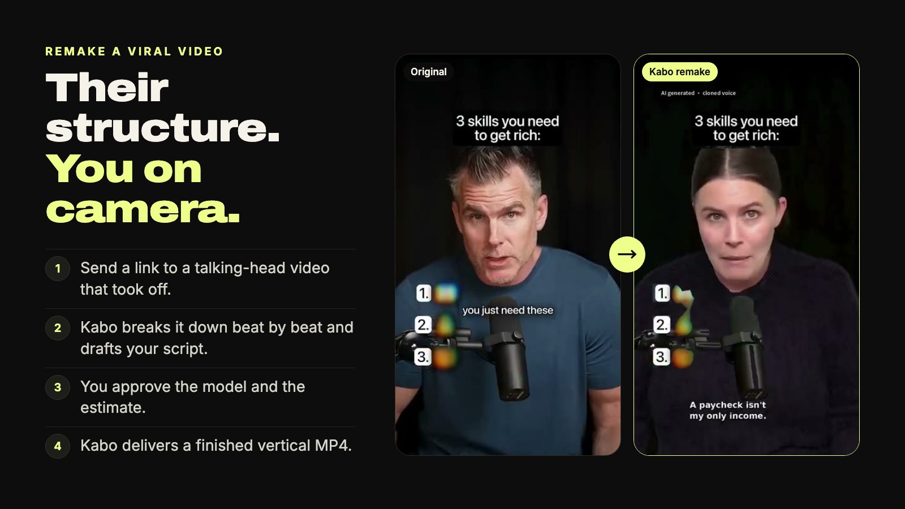
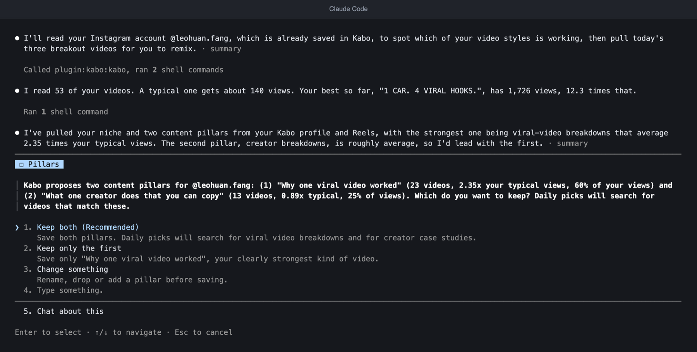
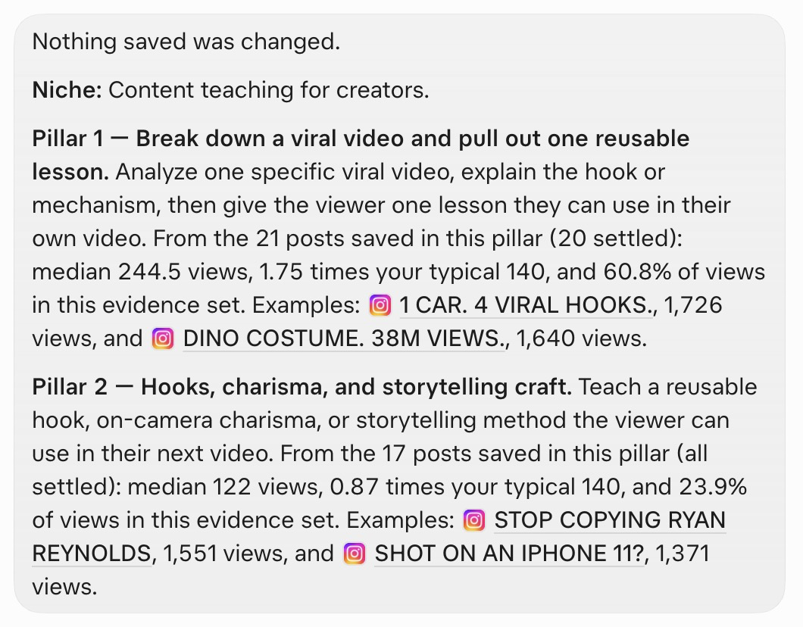
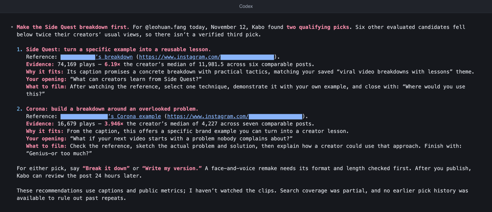
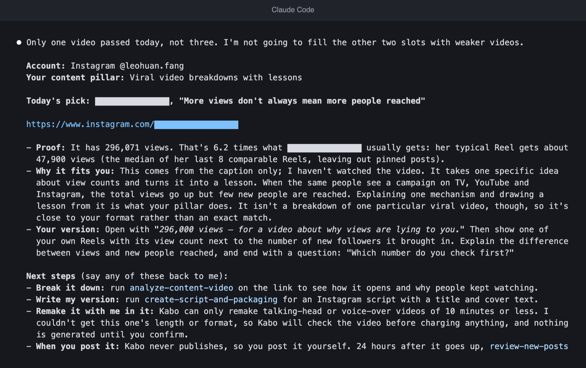
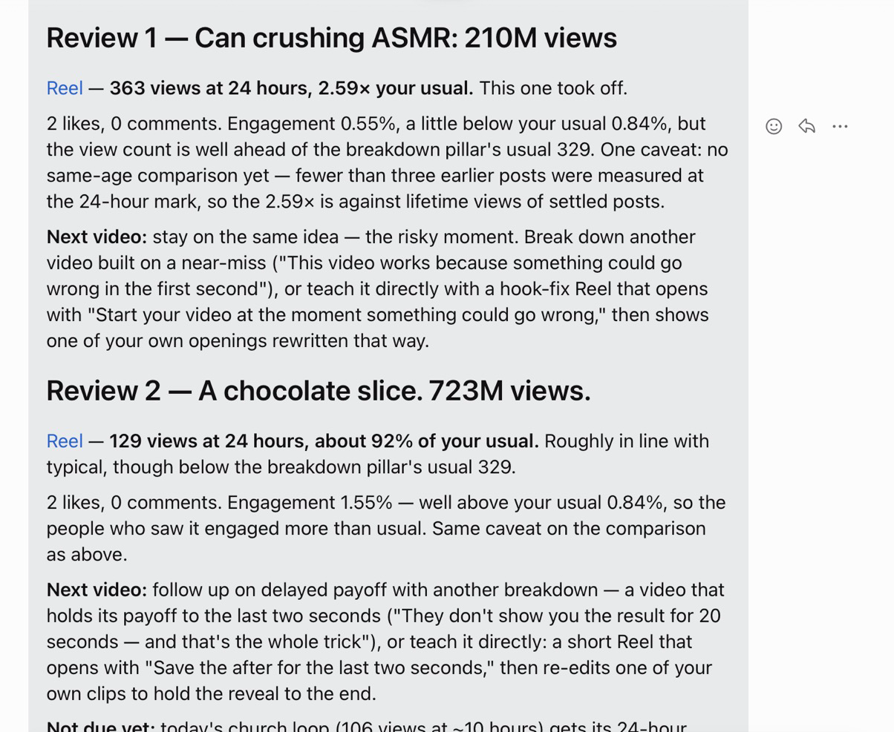
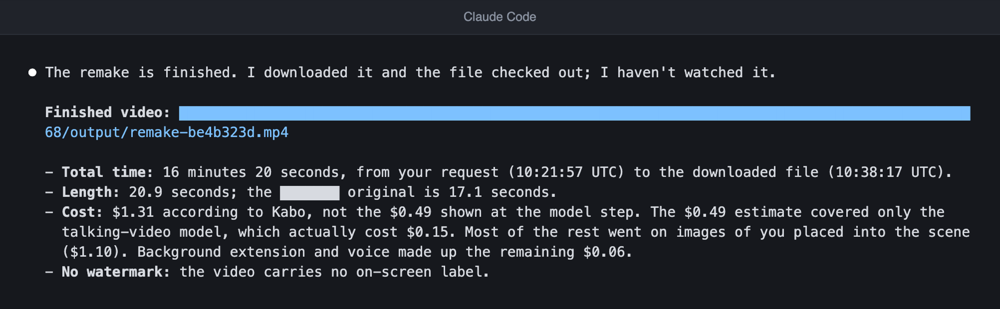

<h1 align="center">Kabo: seu parceiro de criação dentro do Claude, ChatGPT, Grok Bot e Muse</h1>

> Esta página é uma tradução do [README em inglês](../../README.md). Em caso de diferença, vale a versão em inglês.

> ✨ **A geração de vídeo com IA é gratuita por tempo limitado.** Refaça um vídeo viral com você na câmera, sem pagar nada enquanto a oferta durar. [Veja vídeos feitos com o Kabo](https://kabo.sh/?utm_source=github&utm_medium=referral&utm_campaign=202611_mcp_plugin_readme&utm_content=readme_promo).

<p align="center">
  <a href="https://kabo.sh/?utm_source=github&utm_medium=referral&utm_campaign=202611_mcp_plugin_readme&utm_content=readme_hero">
    
  </a>
</p>

<p align="center">
  <a href="https://kabo.sh/?utm_source=github&utm_medium=referral&utm_campaign=202611_mcp_plugin_readme&utm_content=readme_links_website">Site</a> ·
  <a href="#install">Instalar</a> ·
  <a href="https://kabo.sh/docs/mcp?utm_source=github&utm_medium=referral&utm_campaign=202611_mcp_plugin_readme&utm_content=readme_links_docs">Documentação</a> ·
  <a href="https://kabo.sh/pricing?utm_source=github&utm_medium=referral&utm_campaign=202611_mcp_plugin_readme&utm_content=readme_links_pricing">Preços</a> ·
  <a href="https://kabo.sh/tools?utm_source=github&utm_medium=referral&utm_campaign=202611_mcp_plugin_readme&utm_content=readme_links_tools">Ferramentas gratuitas para criadores</a> ·
  <a href="https://github.com/kabo-sh/kabo-mcp-plugin/issues">Reportar um problema</a>
</p>

<p align="center">
  <a href="https://github.com/kabo-sh/kabo-mcp-plugin/releases/latest"></a>
  <a href="../../LICENSE"></a>
  <a href="#install"></a>
  <a href="#what-you-can-do"></a>
  <a href="#install"></a>
</p>

<p align="center">
  <a href="https://kabo.sh/integrations/claude-code?utm_source=github&utm_medium=referral&utm_campaign=202611_mcp_plugin_readme&utm_content=readme_add_claude"></a>
  <a href="https://chatgpt.com/plugins/plugin_asdk_app_6adac6e43f4481918fceac5ade2df2c6"></a>
  <a href="#install"></a>
  <a href="https://kabo.sh/integrations/muse?utm_source=github&utm_medium=referral&utm_campaign=202611_mcp_plugin_readme&utm_content=readme_add_muse"></a>
  <a href="https://kabo.sh/integrations/mcp?utm_source=github&utm_medium=referral&utm_campaign=202611_mcp_plugin_readme&utm_content=readme_add_mcp"></a>
</p>

<p align="center"><a href="../../README.md">English</a> · <a href="README.zh-CN.md">简体中文</a> · <a href="README.es.md">Español</a> · <b>Português</b></p>

O Kabo é um parceiro de IA para criadores do YouTube, Instagram e TikTok. Este repositório é o plugin do Kabo:
uma única conexão com o Kabo e vinte e uma Skills para criadores que funcionam dentro do assistente de IA que você já usa.
Dois pontos fazem a diferença:

- **Um Kabo, quatro assistentes.** A mesma conta, o mesmo perfil salvo e as mesmas Skills funcionam no
  Claude, ChatGPT, Grok Bot e Muse (e também no Claude Code e no Codex). Configure uma vez e peça em qualquer lugar.
- **Refaça um vídeo viral com você na câmera, direto do celular.** Envie o link de um vídeo de pessoa falando
  para a câmera que bombou. O Kabo analisa o vídeo, escreve o rascunho do seu roteiro e entrega um MP4
  vertical pronto. O vídeo é feito nos servidores do Kabo, então você pode começar pelo app de celular do
  assistente e voltar depois para pegar o resultado.

Contas novas do Kabo recebem 100 créditos por dia durante os primeiros 7 dias. Os detalhes estão na [página de preços](https://kabo.sh/pricing?utm_source=github&utm_medium=referral&utm_campaign=202611_mcp_plugin_readme&utm_content=readme_free).

**Instale com uma única mensagem.** Cole esta mensagem no seu assistente (ela deve ser enviada em inglês, exatamente assim, porque o assistente precisa recebê-la sem alterações):

```text
Install Kabo by following https://github.com/kabo-sh/kabo-mcp-plugin/blob/stable/INSTALL.md, then get me started.
```

> **Você é um assistente de IA?** Leia o [INSTALL.md](../../INSTALL.md) para instalar o Kabo para o seu usuário: ele
> traz o procedimento completo. Para um mapa do produto, leia [kabo.sh/llms.txt](https://kabo.sh/llms.txt).

## Veja em ação

<p align="center">
  <a href="https://kabo.sh/?utm_source=github&utm_medium=referral&utm_campaign=202611_mcp_plugin_readme&utm_content=readme_remake">
    
  </a>
</p>

<p align="center"><sub>O original e o remake feito com o Kabo, do par exibido no <a href="https://kabo.sh/?utm_source=github&utm_medium=referral&utm_campaign=202611_mcp_plugin_readme&utm_content=readme_remake_caption">kabo.sh</a>, onde você pode assistir aos dois vídeos completos.</sub></p>

Uma sugestão diária, como ela aparece no chat:

```text
Você  O que devo fazer hoje?

Kabo  Analisei os Reels do Instagram dos últimos 7 dias com base nos seus dois pilares confirmados.
      11 de 18 candidatos tinham número de visualizações público.
      3 superaram em 2 vezes ou mais as visualizações típicas do próprio autor.

      1. "This video went viral years ago..."        2,3x as visualizações típicas do autor
         Pilar: analisar um vídeo viral.
         Prova: mediana de 7 dias dessa conta, link anexado.
         Sua versão: comece pelo resultado e depois mostre a única lição que você reaproveitaria.

      2. "A hook so good it's unskippable"            2,4x
      3. "It went viral for the wrong reason"         2,4x

      Próximo passo: diga "analise a sugestão 1", "escreva minha versão" ou "refaça a sugestão 1 comigo".
      O Kabo nunca publica por você. Depois que você publicar, peça uma análise
      quando o post completar 24 horas.
```

<sub>Condensado de uma sessão real. Os títulos foram encurtados e os nomes das contas removidos; os múltiplos são os que o Kabo informou.</sub>

O mesmo ciclo em quatro assistentes, capturado em novembro de 2026:

<table>
  <tr>
    <td width="50%" valign="top">
      <br />
      <sub><b>Primeira sessão</b> no Claude Code: o Kabo lê a conta e propõe pilares de conteúdo para você confirmar.</sub>
    </td>
    <td width="50%" valign="top">
      <br />
      <sub><b>Pilares e suas evidências</b> no Grok Bot.</sub>
    </td>
  </tr>
  <tr>
    <td width="50%" valign="top">
      <br />
      <sub><b>Sugestões diárias</b> no Codex. Nesse dia dois vídeos passaram do limite de 2 vezes, então o Kabo entregou dois e explicou por que não houve um terceiro.</sub>
    </td>
    <td width="50%" valign="top">
      <br />
      <sub><b>Sugestões diárias</b> no Claude Code no mesmo dia: apenas uma, porque o Kabo não completa a lista com vídeos mais fracos.</sub>
    </td>
  </tr>
  <tr>
    <td width="50%" valign="top">
      <br />
      <sub><b>Revisão de posts novos</b> no Muse: cada post comparado aos números habituais do próprio criador, e depois o próximo vídeo.</sub>
    </td>
    <td width="50%" valign="top">
      <br />
      <sub><b>Remake entregue</b> no Claude Code: um MP4 pronto, com tempo, duração e custo informados.</sub>
    </td>
  </tr>
</table>

<sub>Sessões reais em uma conta de teste pequena, novembro de 2026; a interface e as respostas estão em inglês. Claude Code e Codex são saída de terminal convertida em imagem; Grok Bot e Muse são capturas de tela do app. Os nomes de usuário e links de outros criadores estão ocultos.</sub>

## Sem o Kabo, com o Kabo

**Sem o Kabo**

- ❌ Você rola o feed por uma hora para tentar adivinhar o que está funcionando no seu nicho nesta semana.
- ❌ Você pede ideias a um chatbot e recebe respostas genéricas, sem números e sem fontes.
- ❌ Você encontra um vídeo que vale copiar e perde um dia roteirizando, gravando e editando a sua versão.

**Com o Kabo**

- ✅ Três sugestões toda manhã, alinhadas aos seus próprios pilares de conteúdo, cada uma medida contra as visualizações típicas do próprio autor.
- ✅ Cada descoberta vem com links das fontes, janela de tempo e tamanho da amostra, e diz o que não foi possível medir.
- ✅ Envie o link e receba um remake pronto com você na câmera, no assistente que você já usa.

## O ciclo diário

O Kabo foi feito para ser usado todo dia, não uma vez só.

| Quando | O que você diz | O que o Kabo faz |
| --- | --- | --- |
| **Primeira sessão** | "Me ajude a começar" | Explica o que consegue fazer, conecta uma conta pública do Instagram, TikTok ou YouTube, lê seus posts recentes e propõe o seu nicho e de dois a quatro pilares de conteúdo para você confirmar. |
| **Toda manhã** | "O que devo fazer hoje?" | Escolhe três vídeos curtos dos últimos 7 dias que combinam com os seus pilares e superaram em pelo menos 2 vezes as visualizações típicas do próprio autor. Cada um vem com prova, como adaptar e próximos passos. As sugestões nunca se repetem de um dia para o outro. |
| **Toda noite** | "Analise meus posts novos" | Analisa cada post que passou de 24 horas comparando com os seus posts anteriores na mesma idade e depois faz um resumo da conta: variação de seguidores, os últimos 7 dias em relação às suas visualizações típicas, cada pilar e uma recomendação. |

As duas rotinas diárias podem rodar sozinhas, sem ninguém acompanhando. Assim, você pode colocá-las na agenda
do seu assistente e ler os resultados quando chegarem.

<a id="what-you-can-do"></a>

## O que você pode fazer

| Tarefa | O que o Kabo faz | Skills |
| --- | --- | --- |
| **Começar e manter um ritmo diário** | Configuração da primeira sessão, três sugestões por dia, uma análise de cada post novo | `start-with-kabo` · `pick-daily-viral-videos` · `review-new-posts` |
| **Fazer o vídeo** | Refaz com você um vídeo viral de pessoa falando para a câmera ou com narração de até 10 minutos, cria um a partir de um roteiro aprovado ou altera um já entregue | `remake-viral-video` |
| **Perceber o que está funcionando agora** | Tendências atuais e os padrões por trás dos vídeos de melhor desempenho, medidos contra a linha de base de cada conta | `research-youtube-trends` · `research-instagram-trends` · `research-tiktok-trends` |
| **Estudar concorrentes** | Encontra contas comparáveis, compara o conteúdo recente delas e aponta lacunas de posicionamento | `analyze-creator-competitors` · `analyze-tiktok-competitors` |
| **Analisar uma conta** | O que funciona, o que atrapalha e o que continuar, parar ou testar. A análise aprofundada também assiste aos vídeos. Diagnostica uma queda de alcance | `review-creator-account` · `review-creator-account-deep` · `diagnose-reach-drop` |
| **Dissecar um vídeo** | Uma leitura com marcações de tempo do gancho, do ritmo e da estrutura de um vídeo público ou de um arquivo local | `analyze-content-video` |
| **Decidir o que fazer a seguir** | Ideias de conteúdo a partir da sua conta, das tendências e dos concorrentes, e depois o roteiro, o gancho e o título da ideia que você escolher | `develop-content-ideas` · `create-script-and-packaging` |
| **Planejar quando postar** | Um calendário de conteúdo e horários de postagem baseados no seu próprio histórico | `plan-content-calendar` · `recommend-publish-timing` |
| **Construir a marca e ganhar dinheiro** | Nomes, bios e um media kit; metas mínimas para monetização; precificação item por item para uma proposta de publi | `optimize-creator-brand` · `plan-platform-monetization` · `price-creator-brand-deals` |
| **Conferir uma regra da plataforma** | Verifica uma regra, um limite ou um boato nas páginas oficiais de ajuda, com citações e datas | `verify-platform-rule` |

Peça em linguagem natural. Você não precisa dizer o nome de nenhuma Skill.

```text
Me ajude a começar com o Kabo.
O que devo fazer hoje?
Refaça este vídeo comigo: <link de um vídeo de pessoa falando para a câmera>
Por que o @handle está crescendo tão rápido no Instagram?
Analise o gancho deste Reel: <link>
O alcance do meu TikTok caiu neste mês. O que mudou?
Planeje as minhas próximas quatro semanas de posts.
Quanto devo cobrar por esta proposta de patrocínio? <cole a proposta>
```

<a id="install"></a>

<a id="installation-and-authentication"></a>

## Instalar

O jeito mais rápido é o mesmo em qualquer assistente. Cole esta mensagem (em inglês, exatamente assim, porque o assistente precisa recebê-la sem alterações) e siga o pedido de login:

```text
Install Kabo by following https://github.com/kabo-sh/kabo-mcp-plugin/blob/stable/INSTALL.md, then get me started.
```

O [INSTALL.md](../../INSTALL.md) foi escrito para o assistente: ele ensina como adicionar a conexão com o Kabo,
carregar as Skills e conferir se tudo funciona. O login acontece no seu navegador. Não há nenhuma chave de API para copiar.

**Usa o Claude Code ou o Codex no seu computador?** Um único comando instala o plugin naquele que
encontrar dos dois e depois mostra os passos de login que faltam:

```sh
npx kabo-sh install
```

Acrescente `--dry-run` para ver o que ele executaria sem alterar nada.

**Usa o Grok Bot ou o Muse?** Eles executam o mesmo instalador no próprio computador. Cole isto no chat
(a mensagem deve ficar em inglês) e depois clique no cartão de conexão que aparecer para fazer login:

```text
Install Kabo for me: run `npx -y kabo-sh@latest install` on your computer, read its full output (do not cut it), and do every step it prints. When you need me to sign in, show me the Connect card.
```

| Assistente | Status | Instalar manualmente |
| --- | :---: | --- |
| **Claude** (Claude Code 2.1.275 ou mais recente) | ✅ Compatível | `claude plugin marketplace add kabo-sh/kabo-mcp-plugin`, depois `claude plugin install kabo@kabo-mcp-plugin`. Execute `/mcp` e entre no Kabo. |
| **ChatGPT e Codex** (Codex 0.163 ou mais recente) | ✅ Compatível | Abra Plugins, encontre o Kabo e adicione. Pelo terminal: `codex plugin marketplace add kabo-sh/kabo-mcp-plugin`, depois `codex plugin add kabo@kabo-plugin-openai`. |
| **Grok Bot** | ✅ Compatível | Cole no Bot a mensagem para Grok Bot e Muse acima. Ele instala as Skills no próprio computador e adiciona a conexão do Kabo; você faz login no cartão de conexão. |
| **Muse** | ✅ Compatível | Cole a mensagem para Grok Bot e Muse acima. O Muse instala as Skills nas Skills personalizadas dele e adiciona o Kabo como conector personalizado; você faz login no cartão de conexão. |
| **Cursor e outros clientes MCP** | Ainda não testado | Adicione `https://kabo.sh/mcp-pub` como servidor MCP remoto com OAuth e depois adicione as Skills. |

Você precisa de uma conta do Kabo; entrar com o Google já cria uma. Os fluxos de trabalho precisam de Python 3 e de um
workspace em que o assistente possa ler e escrever.

Guias passo a passo: [kabo.sh/install](https://kabo.sh/install?utm_source=github&utm_medium=referral&utm_campaign=202611_mcp_plugin_readme&utm_content=readme_install) ·
[Configuração do MCP](https://kabo.sh/docs/mcp?utm_source=github&utm_medium=referral&utm_campaign=202611_mcp_plugin_readme&utm_content=readme_install_mcp) ·
[referência completa de instalação](../installation.md#installation-and-authentication)

<a id="skills-only"></a>

### Já conectou o Kabo? Adicione só as Skills

A conexão fornece as ferramentas de dados. As Skills acrescentam os fluxos de trabalho. Se você mesmo conectou
`https://kabo.sh/mcp-pub`, adicione as Skills com um comando e mantenha a sua conexão:

```sh
npx skills add 'kabo-sh/kabo-mcp-plugin#stable' --skill '*'
```

Instalação por Git e ZIP, como fixar uma versão, atualizar e desinstalar estão na
[referência de instalação](../installation.md#skills-only).

## Como funciona

1. **Você pede em linguagem natural.** Seu assistente escolhe a Skill certa.
2. **O Kabo busca dados públicos nos servidores dele.** Não há chaves de API de plataformas para configurar.
3. **Seu assistente faz a análise e escreve o relatório.** As descobertas vêm com links das fontes, a
   janela de tempo, o tamanho da amostra e o que não foi possível medir.

O que o Kabo não faz:

- **Nunca publica por você.** Ele pesquisa, escreve rascunhos e faz o vídeo; postar continua com você.
- **Não chuta métricas privadas.** Taxa de cliques, retenção, receita e Insights nunca são
  deduzidos a partir de visualizações ou curtidas públicas.
- **Não promete viralização.** Quando as evidências são fracas, o relatório avisa.

## Como o Kabo se compara

Nós fazemos o Kabo, então leia isto como a nossa opinião. Cada célula do vidIQ, do TubeBuddy e do Viewstats vem das
páginas do próprio produto
([vidiq.com/mcp](https://vidiq.com/mcp/), [vidiq.com/pricing](https://vidiq.com/pricing/), [tubebuddy.com/pricing](https://www.tubebuddy.com/pricing),
[viewstats.com](https://www.viewstats.com/)), conferidas em novembro de 2026. Se algo mudou,
por favor [abra uma issue](https://github.com/kabo-sh/kabo-mcp-plugin/issues).

| | Kabo | vidIQ | TubeBuddy | Viewstats |
| --- | --- | --- | --- | --- |
| Onde você usa | Dentro do Claude, ChatGPT, Grok Bot e Muse, no navegador e nos apps de iPhone e Android | App web, extensão de navegador e apps de celular, além de um servidor MCP para ChatGPT, Claude, Muse, Cursor, Grok, Codex e outros clientes | Extensão do Chrome e app de celular para YouTube | App web |
| Plataformas | YouTube, Instagram e TikTok | YouTube primeiro, com pesquisa pública de Instagram | YouTube | YouTube |
| Faz um vídeo pronto com você na câmera | Sim: refaz um vídeo viral de pessoa falando para a câmera e entrega um MP4 pronto | A lista de ferramentas MCP dele inclui cortes de vídeos longos e miniaturas com IA | Não: ferramentas de vídeo e de miniatura | Não: busca de miniaturas e ideias de vídeo |
| Sugestões diárias alinhadas aos seus próprios pilares de conteúdo | Sim, até três por dia | Daily Ideas para o seu canal do YouTube | Next Video Ideas | Ferramenta Outliers com filtros |
| Pontuação de palavras-chave do YouTube | Sem pontuação de palavras-chave dedicada | Sim | Sim: Keyword Explorer | Não listado |
| Altera o seu canal | Nunca: não publica nem edita | Com a sua aprovação, atualiza títulos, descrições, tags e miniaturas, responde comentários e publica Reels do Instagram | Edição em massa e publicação agendada | Não listado |
| Grátis para começar | 100 créditos por dia nos primeiros 7 dias de uma conta nova; geração de vídeo com IA gratuita por tempo limitado | Plano gratuito com 150 créditos de IA por mês | Veja a página de preços dele | Conta gratuita; o Pro é pago |

Escolha o vidIQ se palavras-chave do YouTube e as análises conectadas do seu próprio canal são o centro do trabalho.
Escolha o TubeBuddy para palavras-chave do YouTube e ferramentas que editam o seu canal. Escolha o
Viewstats para explorar outliers e miniaturas do YouTube. Escolha o Kabo se você quer um parceiro para YouTube,
Instagram e TikTok que funcione no assistente que você já usa e leve uma ideia até
um vídeo pronto. Comparações mais longas: [kabo.sh/alternatives](https://kabo.sh/alternatives?utm_source=github&utm_medium=referral&utm_campaign=202611_mcp_plugin_readme&utm_content=readme_compare).

## Preços

- **A geração de vídeo com IA é gratuita por tempo limitado.**
- **Grátis para começar.** Contas novas recebem 100 créditos por dia nos primeiros 7 dias.
- **Planos.** Pro e Ultra acrescentam créditos diários. Os preços atuais estão na
  [página de preços](https://kabo.sh/pricing?utm_source=github&utm_medium=referral&utm_campaign=202611_mcp_plugin_readme&utm_content=readme_pricing).

Antes de um remake começar, o Kabo mostra as opções de modelo e uma estimativa, e espera a sua aprovação.

## Privacidade

A pesquisa sobre criadores usa dados públicos buscados pelos servidores do Kabo. O login usa OAuth no seu navegador;
seu assistente nunca vê uma senha do Kabo. O plugin pede acesso de leitura e escrita ao seu workspace do Kabo
para poder vincular a sua conta e salvar seus pilares, roteiros e preferências; veja
[Seu trabalho salvo no Kabo](../workspace.md). [Privacidade](https://kabo.sh/privacy) · [Termos](https://kabo.sh/terms)

## Mais do Kabo

- **[Kabo no navegador](https://kabo.sh/?utm_source=github&utm_medium=referral&utm_campaign=202611_mcp_plugin_readme&utm_content=readme_more_web)**: o workspace completo, sem configuração.
- **Kabo para [iPhone](https://apps.apple.com/us/app/kabo-ai-creator-coach/id6800972386) e [Android](https://play.google.com/store/apps/details?id=com.dealism.kabo)**: feedback sobre o vídeo antes de publicar, onde você estiver.
- **[Ferramentas gratuitas para criadores](https://kabo.sh/tools?utm_source=github&utm_medium=referral&utm_campaign=202611_mcp_plugin_readme&utm_content=readme_more_tools)**: calculadoras, verificadores e geradores. Sem precisar de conta.

## Novidades

Novidades de novembro de 2026:

- **O ciclo diário.** `start-with-kabo`, `pick-daily-viral-videos` e `review-new-posts` configuram tudo uma vez e depois trazem sugestões e análises de posts todo dia.
- **Remake a partir dos seus próprios arquivos.** `remake-viral-video` agora aceita vídeos e fotos do seu dispositivo, além de links públicos.
- **Instalação em uma mensagem para qualquer assistente.** O [INSTALL.md](../../INSTALL.md) permite que Grok Bot, Muse e outros assistentes instalem o Kabo para você.

Todas as versões estão listadas na [página de releases](https://github.com/kabo-sh/kabo-mcp-plugin/releases).

## Perguntas frequentes

<details>
<summary><b>O que é o Kabo?</b></summary>

O Kabo é um parceiro de IA para criadores. Você pede em linguagem natural; ele pesquisa dados públicos de criadores,
explica o que está funcionando e transforma essas evidências em vídeos que você pode fazer. Este plugin leva o Kabo
para o assistente de IA que você já usa. O Kabo também funciona [no navegador](https://kabo.sh/?utm_source=github&utm_medium=referral&utm_campaign=202611_mcp_plugin_readme&utm_content=readme_faq_web).
</details>

<details>
<summary><b>Quais assistentes e plataformas ele suporta?</b></summary>

Assistentes: Claude (Claude Code), ChatGPT e Codex, Grok Bot e Muse. Outros assistentes que aceitam
servidores MCP remotos com OAuth também podem se conectar; veja [Instalar](#install). Plataformas: YouTube, Instagram
e TikTok.
</details>

<details>
<summary><b>É grátis?</b></summary>

A geração de vídeo com IA é gratuita por tempo limitado. Contas novas recebem 100 créditos por dia nos primeiros
7 dias. Depois disso, veja a [página de preços](https://kabo.sh/pricing?utm_source=github&utm_medium=referral&utm_campaign=202611_mcp_plugin_readme&utm_content=readme_faq_pricing). O
plugin em si é de código aberto, sob a licença MIT.
</details>

<details>
<summary><b>Dá mesmo para refazer um vídeo pelo celular?</b></summary>

Dá. O vídeo é feito nos servidores do Kabo, não no seu dispositivo. Peça o remake no app de celular do seu
assistente, aprove o modelo e a estimativa e volte depois para pegar o MP4 pronto.
</details>

<details>
<summary><b>O que significa "evidências anexadas"?</b></summary>

O Kabo mantém junto da resposta os links das fontes, a janela de comparação e as marcações de tempo por trás de uma
conclusão. Quando as evidências são fracas, ele avisa em vez de apresentar um palpite como fato. A análise dele
não pode garantir alcance, visualizações nem crescimento.
</details>

<details>
<summary><b>O Kabo posta por mim ou altera a minha conta?</b></summary>

Não. O Kabo pesquisa, escreve rascunhos e faz o vídeo. Publicar continua com você, e o Kabo trabalha com dados
públicos: ele não lê as suas análises privadas.
</details>

## Para quem mantém o projeto

- [Referência de instalação](../installation.md): versão atual, instalações só das Skills, detalhes por host, requisitos, atualização, desinstalação e reversão.
- [Desenvolvimento e releases](../development.md): estrutura do repositório, verificações, geração do pacote, aceitação.
- [Seu trabalho salvo no Kabo](../workspace.md): o que o plugin lê e escreve em um workspace do Kabo.
- [Especificação das Skills](../skills-spec.md) · [Changelog](../../CHANGELOG.md) · [Instruções para assistentes de IA](../../INSTALL.md)

## Licença

[MIT](../../LICENSE)
