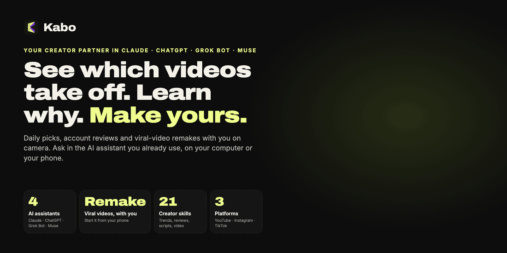
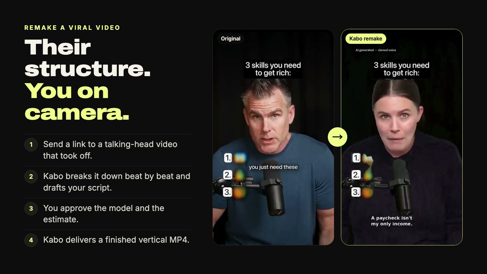
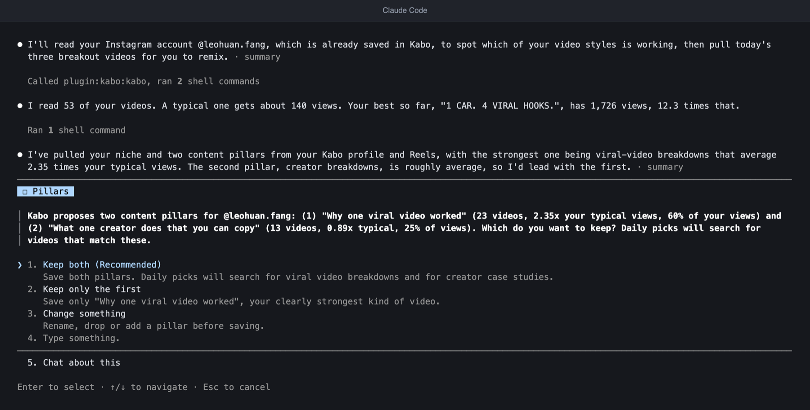
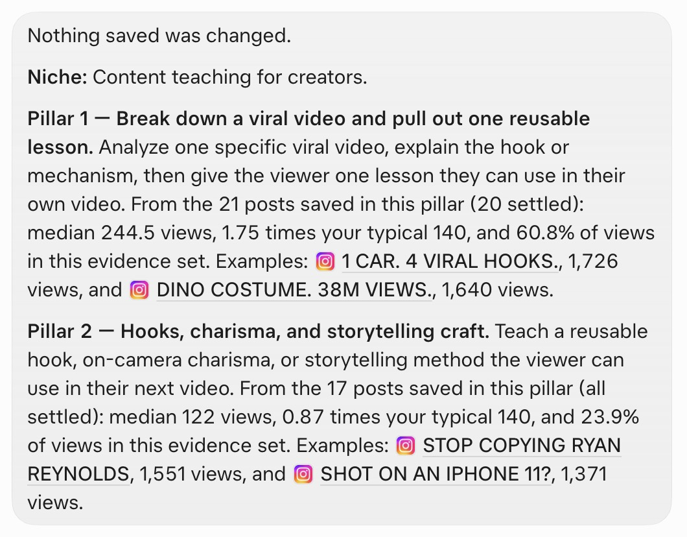
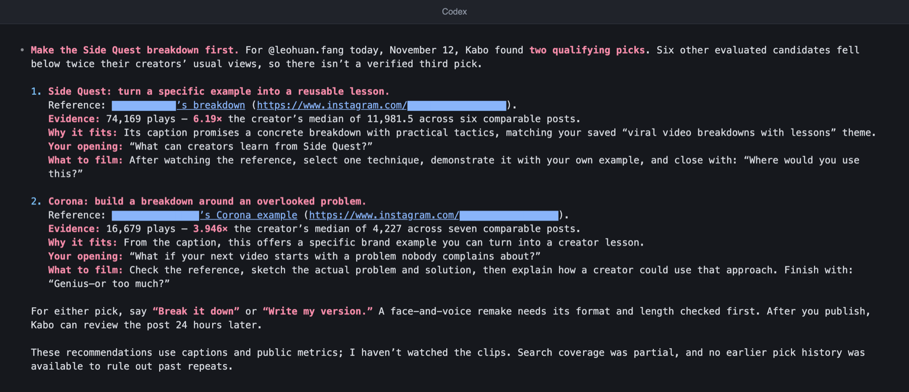
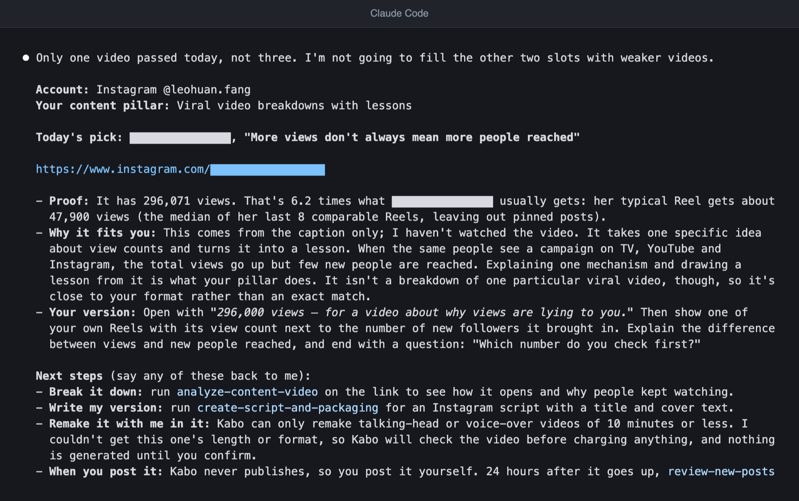
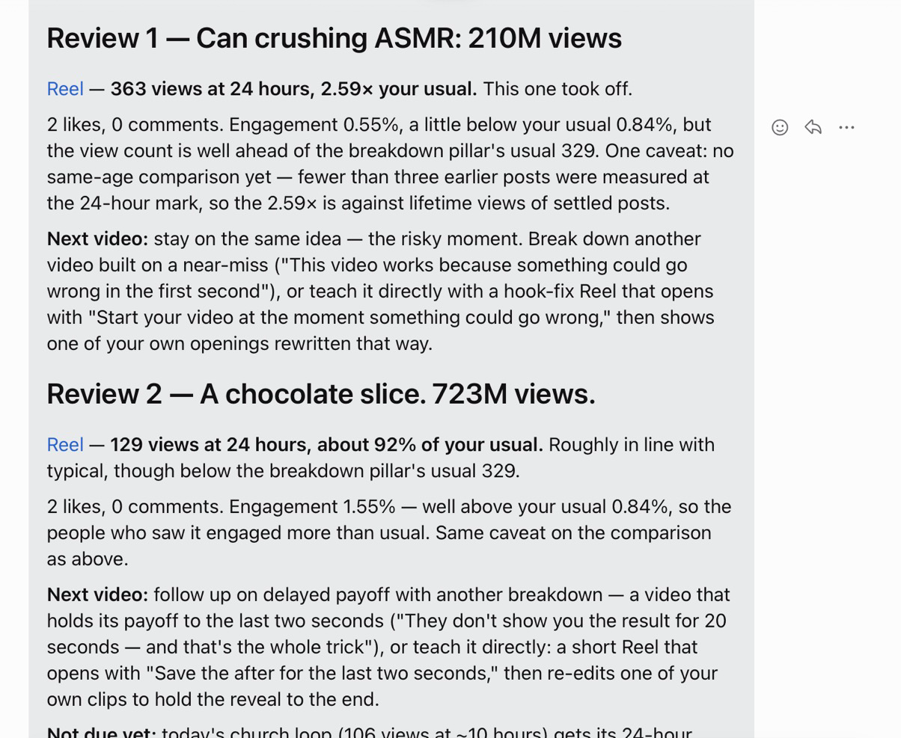
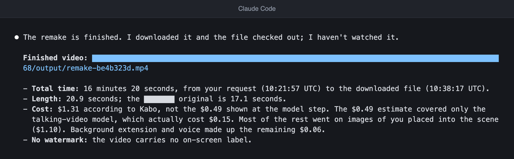

<h1 align="center">Kabo：住在 Claude、ChatGPT、Grok Bot 和 Muse 里的创作者搭档</h1>

> 本页是英文版 [README](../../README.md) 的翻译；内容有出入时以英文版为准。

> ✨ **AI 视频生成限时免费。** 优惠期内，免费把一条爆款视频翻拍成由你本人出镜的版本。[看看用 Kabo 做出来的视频](https://kabo.sh/?utm_source=github&utm_medium=referral&utm_campaign=202611_mcp_plugin_readme&utm_content=readme_promo)。

<p align="center">
  <a href="https://kabo.sh/?utm_source=github&utm_medium=referral&utm_campaign=202611_mcp_plugin_readme&utm_content=readme_hero">
    
  </a>
</p>

<p align="center">
  <a href="https://kabo.sh/?utm_source=github&utm_medium=referral&utm_campaign=202611_mcp_plugin_readme&utm_content=readme_links_website">官网</a> ·
  <a href="#install">安装</a> ·
  <a href="https://kabo.sh/docs/mcp?utm_source=github&utm_medium=referral&utm_campaign=202611_mcp_plugin_readme&utm_content=readme_links_docs">文档</a> ·
  <a href="https://kabo.sh/pricing?utm_source=github&utm_medium=referral&utm_campaign=202611_mcp_plugin_readme&utm_content=readme_links_pricing">价格</a> ·
  <a href="https://kabo.sh/tools?utm_source=github&utm_medium=referral&utm_campaign=202611_mcp_plugin_readme&utm_content=readme_links_tools">免费创作者工具</a> ·
  <a href="https://github.com/kabo-sh/kabo-mcp-plugin/issues">反馈问题</a>
</p>

<p align="center">
  <a href="https://github.com/kabo-sh/kabo-mcp-plugin/releases/latest"></a>
  <a href="../../LICENSE"></a>
  <a href="#install"></a>
  <a href="#what-you-can-do"></a>
  <a href="#install"></a>
</p>

<p align="center">
  <a href="https://kabo.sh/mcp/claude-code?utm_source=github&utm_medium=referral&utm_campaign=202611_mcp_plugin_readme&utm_content=readme_add_claude"></a>
  <a href="https://kabo.sh/mcp/codex?utm_source=github&utm_medium=referral&utm_campaign=202611_mcp_plugin_readme&utm_content=readme_add_chatgpt"></a>
  <a href="https://kabo.sh/mcp/grok-bot?utm_source=github&utm_medium=referral&utm_campaign=202611_mcp_plugin_readme&utm_content=readme_add_grok"></a>
  <a href="https://kabo.sh/mcp/muse?utm_source=github&utm_medium=referral&utm_campaign=202611_mcp_plugin_readme&utm_content=readme_add_muse"></a>
  <a href="https://kabo.sh/integrations/mcp?utm_source=github&utm_medium=referral&utm_campaign=202611_mcp_plugin_readme&utm_content=readme_add_mcp"></a>
</p>

<p align="center"><a href="../../README.md">English</a> · <b>简体中文</b> · <a href="README.es.md">Español</a> · <a href="README.pt-BR.md">Português</a></p>

Kabo 是 YouTube、Instagram 和 TikTok 创作者的 AI 搭档。这个仓库就是 Kabo 插件：
一个通往 Kabo 的连接，加上二十一个创作者技能（Skills），都直接运行在你已经在用的 AI 助手里。
它有两点与众不同：

- **一个 Kabo，四个助手。** 同一个账号、同一份已保存的个人档案、同一套技能，在
  Claude、ChatGPT、Grok Bot 和 Muse 里都能用（Claude Code 和 Codex 里也一样）。设置一次，随处提问。
- **用手机就能让一条爆款视频换成你本人出镜。** 发给 Kabo 一条爆火的口播视频链接，
  它会拆解这条视频、起草你的脚本，最后交付一条做好的竖屏 MP4。
  视频是在 Kabo 的服务器上制作的，所以你可以在助手的手机 App 里发起，过一会儿回来取成片。

新注册的 Kabo 账号，前 7 天每天有 100 点积分。详情见[价格页](https://kabo.sh/pricing?utm_source=github&utm_medium=referral&utm_campaign=202611_mcp_plugin_readme&utm_content=readme_free)。

**一条消息完成安装。** 把下面这句话发给你的助手（请保持英文原文，助手需要原样收到）：

```text
Install Kabo by following https://github.com/kabo-sh/kabo-mcp-plugin/blob/stable/INSTALL.md, then get me started.
```

> **你是 AI 助手吗？** 请阅读 [INSTALL.md](../../INSTALL.md) 来为你的用户安装 Kabo：那里有完整步骤。
> 想了解产品全貌，请看 [kabo.sh/llms.txt](https://kabo.sh/llms.txt)。

## 看看实际效果

<p align="center">
  <a href="https://kabo.sh/?utm_source=github&utm_medium=referral&utm_campaign=202611_mcp_plugin_readme&utm_content=readme_remake">
    
  </a>
</p>

<p align="center"><sub>原版视频和它的 Kabo 翻拍版，取自 <a href="https://kabo.sh/?utm_source=github&utm_medium=referral&utm_campaign=202611_mcp_plugin_readme&utm_content=readme_remake_caption">kabo.sh</a> 上展示的那一对，在那里可以完整观看两条视频。</sub></p>

一条每日精选在聊天里是这样的：

```text
你    我今天该做什么？

Kabo  我对照你确认过的两个内容方向，扫描了过去 7 天的 Instagram Reels。
      18 条候选里，有 11 条能看到公开播放量。
      其中 3 条的播放量达到了作者自己平时水平的 2 倍或以上。

      1.「这条视频多年前就火过……」                 是作者平时播放量的 2.3 倍
         内容方向：拆解一条爆款视频。
         依据：该账号 7 天播放量中位数，已附链接。
         你的版本：开头先放结果，再讲你会复用的那一条经验。

      2.「好到让人舍不得划走的开头」                 2.4 倍
      3.「它火起来的原因其实不对」                   2.4 倍

      下一步：你可以说“拆解第 1 条”“写我的版本”，或者“把第 1 条翻拍成我出镜的版本”。
      Kabo 从不替你发布。发布之后，等帖子满 24 小时，
      再来让我复盘。
```

<sub>节选自一次真实对话。标题做了缩短，账号名已隐去；倍数是 Kabo 当时给出的原值。</sub>

同一套每日流程在四个助手里的实际画面，截于 2026 年 11 月：

<table>
  <tr>
    <td width="50%" valign="top">
      <br />
      <sub><b>第一次使用</b>（Claude Code）：Kabo 读取账号后提出内容方向，等你确认。</sub>
    </td>
    <td width="50%" valign="top">
      <br />
      <sub><b>内容方向及其依据</b>（Grok Bot）。</sub>
    </td>
  </tr>
  <tr>
    <td width="50%" valign="top">
      <br />
      <sub><b>每日精选</b>（Codex）。当天只有两条视频达到 2 倍门槛，所以 Kabo 只给了两条，并说明了为什么没有第三条。</sub>
    </td>
    <td width="50%" valign="top">
      <br />
      <sub><b>每日精选</b>（Claude Code，同一天）：只有一条，因为 Kabo 不会用较弱的视频凑数。</sub>
    </td>
  </tr>
  <tr>
    <td width="50%" valign="top">
      <br />
      <sub><b>新作品复盘</b>（Muse）：每条作品都和创作者自己平时的数据比较，再给出下一条视频的建议。</sub>
    </td>
    <td width="50%" valign="top">
      <br />
      <sub><b>翻拍成片交付</b>（Claude Code）：一条做好的 MP4，并报告用时、时长和费用。</sub>
    </td>
  </tr>
</table>

<sub>以上均为一个小型测试账号在 2026 年 11 月的真实会话，界面与回答为英文原样。Claude Code 和 Codex 是把终端输出渲染成图片；Grok Bot 和 Muse 是应用截图。其他创作者的账号名和链接已遮盖。</sub>

## 没有 Kabo，有了 Kabo

**没有 Kabo**

- ❌ 你要刷上一个小时，才能猜出这周你所在的领域什么内容在起量。
- ❌ 你向聊天机器人要选题，得到的都是千篇一律的点子，没有数字，也没有来源。
- ❌ 你找到一条值得模仿的视频，却要花一整天去写脚本、拍摄、剪辑你自己的版本。

**有了 Kabo**

- ✅ 每天早上三条精选，贴合你自己的内容方向，每一条都对照作者平时的播放量来衡量。
- ✅ 每个发现都附有来源链接、时间范围和样本量，还会告诉你哪些东西没法衡量。
- ✅ 发一个链接，就能拿到由你本人出镜的成片，全程在你已经在用的助手里完成。

## 每日节奏

Kabo 是设计来天天用的，不是用一次就丢。

| 时间 | 你说什么 | Kabo 做什么 |
| --- | --- | --- |
| **第一次使用** | “带我上手” | 介绍它能做什么，绑定一个公开的 Instagram、TikTok 或 YouTube 账号，读取你最近的帖子，并提出你的领域和两到四个内容方向，让你确认。 |
| **每天早上** | “我今天该做什么？” | 从过去 7 天里挑出三条符合你内容方向的短视频，要求播放量至少达到作者自己平时水平的 2 倍。每条都附依据、改编方法和下一步。同样的精选不会跨天重复。 |
| **每天晚上** | “复盘一下我的新帖子” | 对每条已发布满 24 小时的帖子，拿你自己更早发布的、同样发布时长的帖子作对照来复盘，然后对账号做总结：粉丝变化、过去 7 天相对你平时播放量的表现、每个内容方向的情况，以及一条建议。 |

这两项每日任务都可以无人值守地运行，所以你可以把它们放进助手的定时任务里，等结果送到再看。

<a id="what-you-can-do"></a>

## 你能用它做什么

| 要做的事 | Kabo 怎么做 | 技能 |
| --- | --- | --- |
| **开始使用，并养成每日节奏** | 首次使用的设置、每天三条精选、每条新帖子的复盘 | `start-with-kabo` · `pick-daily-viral-videos` · `review-new-posts` |
| **把视频做出来** | 把最长 10 分钟的爆款口播或配音视频翻拍成由你出镜的版本，根据你确认过的脚本做一条视频，或者修改已交付的视频 | `remake-viral-video` |
| **发现现在什么在起量** | 当前趋势，以及表现突出的内容背后的规律，并对照每个账号自己的基准来衡量 | `research-youtube-trends` · `research-instagram-trends` · `research-tiktok-trends` |
| **研究同行** | 找到可比的账号，对比他们最近的内容，指出定位上的空白 | `analyze-creator-competitors` · `analyze-tiktok-competitors` |
| **复盘账号** | 什么有效、什么在拖后腿，以及哪些该继续、停掉或试一试。深度复盘还会真正去看视频。也能诊断流量下滑 | `review-creator-account` · `review-creator-account-deep` · `diagnose-reach-drop` |
| **拆解一条视频** | 带时间戳地解读一条公开视频或本地文件的开头钩子、节奏和结构 | `analyze-content-video` |
| **决定下一条做什么** | 根据你的账号、趋势和同行给出内容选题，再为你选中的那个写出脚本、开头钩子和标题 | `develop-content-ideas` · `create-script-and-packaging` |
| **规划什么时候发** | 内容日历，以及根据你自己的历史数据得出的发布时间 | `plan-content-calendar` · `recommend-publish-timing` |
| **打造个人品牌并变现** | 名字、简介和媒体资料包；变现门槛；针对品牌合作需求单的分项报价 | `optimize-creator-brand` · `plan-platform-monetization` · `price-creator-brand-deals` |
| **核对平台规则** | 对照官方帮助页，核实某条规则、门槛或传言，附上引文和日期 | `verify-platform-rule` |

用平常说话的方式提问就行，不需要说出技能的名字。

```text
带我上手 Kabo。
我今天该做什么？
把这条视频翻拍成我出镜的版本：<口播视频链接>
为什么 @handle 在 Instagram 上涨得这么快？
拆解一下这条 Reel 的开头钩子：<链接>
我这个月的 TikTok 流量下滑了，是哪里变了？
帮我规划接下来四周的帖子。
这份赞助合作需求单我该报多少钱？<粘贴需求单>
```

<a id="installation-and-authentication"></a>

<a id="install"></a>

## 安装

最快的办法在每个助手上都一样。粘贴下面这条消息，然后按提示登录：

```text
Install Kabo by following https://github.com/kabo-sh/kabo-mcp-plugin/blob/stable/INSTALL.md, then get me started.
```

[INSTALL.md](../../INSTALL.md) 是写给助手看的：它会告诉助手怎样添加 Kabo 连接、加载技能，并检查一切是否正常。登录在你的浏览器里完成，不需要复制任何 API 密钥。

**在自己电脑上用 Claude Code 或 Codex？** 一条命令就能装好：它会检查电脑上装了这两个中的哪一个，
替你装上插件，然后告诉你还剩哪几步登录要你自己完成：

```sh
npx -y kabo-sh install
```

加上 `--dry-run` 可以只看它会执行什么、不做任何改动。

**用 Grok Bot 或 Muse？** 它们会在自己的电脑上运行同一个安装程序。把下面这句话粘贴到对话里（请保持英文原文），
然后点它弹出的连接卡片登录：

```text
Install Kabo for me: run `npx -y kabo-sh@latest install` on your computer, read its full output (do not cut it), and do every step it prints. When you need me to sign in, show me the Connect card.
```

| 助手 | 状态 | 手动安装 |
| --- | :---: | --- |
| **Claude**（Claude Code 2.1.275 或更高版本） | ✅ 已支持 | `claude plugin marketplace add kabo-sh/kabo-mcp-plugin`，然后 `claude plugin install kabo@kabo-mcp-plugin`。运行 `/mcp`，登录 Kabo。 |
| **ChatGPT 和 Codex**（Codex 0.163 或更高版本） | ✅ 已支持 | 打开插件，找到 Kabo 并添加。从终端安装：`codex plugin marketplace add kabo-sh/kabo-mcp-plugin`，然后 `codex plugin add kabo@kabo-plugin-openai`。 |
| **Grok Bot** | ✅ 已支持 | 把上面给 Grok Bot 和 Muse 的那句话粘贴给 Bot。它会在自己的电脑上装好技能、加上 Kabo 连接，你在连接卡片上登录。 |
| **Muse** | ✅ 已支持 | 粘贴上面给 Grok Bot 和 Muse 的那句话。Muse 会把技能装进它的自定义技能，并把 Kabo 添加为自定义连接器，你在连接卡片上登录。 |
| **Cursor 和其他 MCP 客户端** | 尚未测试 | 把 `https://kabo.sh/mcp-pub` 作为支持 OAuth 的远程 MCP 服务器添加进去，再添加技能。 |

你需要一个 Kabo 账号；用 Google 登录就会自动创建。这些工作流需要 Python 3，以及一个助手可以读写的工作区。

分步指南：[kabo.sh/mcp/install](https://kabo.sh/mcp/install?utm_source=github&utm_medium=referral&utm_campaign=202611_mcp_plugin_readme&utm_content=readme_install) ·
[MCP 设置](https://kabo.sh/docs/mcp?utm_source=github&utm_medium=referral&utm_campaign=202611_mcp_plugin_readme&utm_content=readme_install_mcp) ·
[完整安装参考](../installation.md#installation-and-authentication)

<a id="skills-only"></a>

### 已经连接过 Kabo？只需添加技能

连接提供数据工具，技能提供工作流。如果你已经自己连接了
`https://kabo.sh/mcp-pub`，用一条命令添加技能即可，原来的连接保持不变：

```sh
npx skills add 'kabo-sh/kabo-mcp-plugin#stable' --skill '*'
```

用 Git 和 ZIP 安装、固定版本、更新和卸载的方法，见
[安装参考](../installation.md#skills-only)。

## 它是怎么运作的

1. **你用平常说话的方式提问。** 你的助手会挑选对应的技能。
2. **Kabo 在它的服务器上获取公开数据。** 你不需要设置任何平台 API 密钥。
3. **你的助手负责分析并写出报告。** 每个发现都附有来源链接、时间范围、样本量，以及哪些东西没法衡量。

Kabo 不做的事：

- **它从不替你发布。** 它负责调研、起草和制作视频；发帖由你自己来。
- **它不会去猜私有数据。** 点击率、观众留存、收入和 Insights 后台数据，绝不会根据公开的播放量或点赞数推算。
- **它不承诺一定火。** 证据不足的时候，报告会直说。

## Kabo 和别的工具比起来怎么样

Kabo 是我们做的，所以请把这部分当作我们自己的看法。表中 vidIQ、TubeBuddy 和 Viewstats 的每一格，
都来自这几个产品自己的页面
（[vidiq.com/mcp](https://vidiq.com/mcp/)、[vidiq.com/pricing](https://vidiq.com/pricing/)、[tubebuddy.com/pricing](https://www.tubebuddy.com/pricing)、
[viewstats.com](https://www.viewstats.com/)），核对时间为 2026 年 11 月。如果有变化，
请[提一个 issue](https://github.com/kabo-sh/kabo-mcp-plugin/issues)。

| | Kabo | vidIQ | TubeBuddy | Viewstats |
| --- | --- | --- | --- | --- |
| 在哪里用 | 在 Claude、ChatGPT、Grok Bot 和 Muse 里，在浏览器里，以及 iPhone 和 Android App 里 | 网页应用、浏览器扩展和手机 App，另有一个 MCP 服务，可接入 ChatGPT、Claude、Muse、Cursor、Grok、Codex 等客户端 | 面向 YouTube 的 Chrome 扩展和手机 App | 网页应用 |
| 支持的平台 | YouTube、Instagram 和 TikTok | 以 YouTube 为主，另有 Instagram 公开数据研究 | YouTube | YouTube |
| 能否做出由你出镜的成片 | 能：把爆款口播视频翻拍成做好的 MP4 | 它的 MCP 工具清单里有长视频切片和 AI 封面 | 不能：提供视频和封面工具 | 不能：提供封面搜索和视频选题 |
| 贴合你自己内容方向的每日精选 | 有，每天最多三条 | 有面向你 YouTube 频道的每日选题（Daily Ideas） | 有“下一条视频选题”（Next Video Ideas） | 有带筛选条件的爆款视频工具（Outliers） |
| YouTube 关键词评分 | 没有专门的关键词评分 | 有 | 有：关键词探索器（Keyword Explorer） | 未列出 |
| 会不会改动你的频道 | 绝不：它不发布，也不编辑 | 经你同意后，可以修改标题、简介、标签和封面，回复评论，并发布 Instagram Reels | 批量编辑和定时发布 | 未列出 |
| 免费开始 | 新账号前 7 天每天 100 点积分；AI 视频生成限时免费 | 免费版每月 150 点 AI 积分 | 见其价格页 | 免费账号；Pro 版收费 |

如果你的核心需求是 YouTube 关键词，以及接入你自己频道后台数据的分析，选 vidIQ。
需要 YouTube 关键词和能直接修改频道的工具，选 TubeBuddy。
想浏览 YouTube 上的爆款视频和封面，选 Viewstats。想要一个横跨 YouTube、
Instagram 和 TikTok、在你已经在用的助手里工作、并且能把一个想法一路带到成片的搭档，选 Kabo。更详细的对比：[kabo.sh/alternatives](https://kabo.sh/alternatives?utm_source=github&utm_medium=referral&utm_campaign=202611_mcp_plugin_readme&utm_content=readme_compare)。

## 价格

- **AI 视频生成限时免费。**
- **免费开始。** 新账号前 7 天每天有 100 点积分。
- **套餐。** Pro 和 Ultra 提供更多每日积分。当前价格见
  [价格页](https://kabo.sh/pricing?utm_source=github&utm_medium=referral&utm_campaign=202611_mcp_plugin_readme&utm_content=readme_pricing)。

翻拍开始之前，Kabo 会先给出可选的模型和费用估算，等你确认后才会动手。

## 隐私

创作者调研用的是 Kabo 服务器获取的公开数据。登录通过你浏览器里的 OAuth 完成；
你的助手永远看不到 Kabo 的密码。插件会请求读写你 Kabo 工作区的权限，
以便关联你的账号，并保存你的内容方向、脚本和偏好设置；详见
[你保存在 Kabo 里的内容](../workspace.md)。[隐私政策](https://kabo.sh/privacy) · [服务条款](https://kabo.sh/terms)

## Kabo 的更多产品

- **[浏览器里的 Kabo](https://kabo.sh/?utm_source=github&utm_medium=referral&utm_campaign=202611_mcp_plugin_readme&utm_content=readme_more_web)**：完整的工作区，无需设置。
- **Kabo [iPhone 版](https://apps.apple.com/us/app/kabo-ai-creator-coach/id6800972386)和 [Android 版](https://play.google.com/store/apps/details?id=com.dealism.kabo)**：随时随地在发布前获得视频反馈。
- **[免费创作者工具](https://kabo.sh/tools?utm_source=github&utm_medium=referral&utm_campaign=202611_mcp_plugin_readme&utm_content=readme_more_tools)**：计算器、检查器和生成器，不需要账号。

## 新动态

2026 年 11 月的更新：

- **每日节奏。** `start-with-kabo`、`pick-daily-viral-videos` 和 `review-new-posts` 先帮你一次设置好，之后每天给你送来精选和帖子复盘。
- **用你自己的文件翻拍。** `remake-viral-video` 现在除了公开链接，也接受你设备上的视频和照片。
- **任何助手都能一条消息安装。** [INSTALL.md](../../INSTALL.md) 让 Grok Bot、Muse 和其他助手可以替你安装 Kabo。

每个版本都列在[发布页](https://github.com/kabo-sh/kabo-mcp-plugin/releases)。

## 常见问题

<details>
<summary><b>Kabo 是什么？</b></summary>

Kabo 是创作者的 AI 搭档。你用平常说话的方式提问；它去调研公开的创作者数据，
解释什么内容有效，再把这些证据变成你能做出来的视频。这个插件把 Kabo
带进你已经在用的 AI 助手里。Kabo 也可以[在浏览器里](https://kabo.sh/?utm_source=github&utm_medium=referral&utm_campaign=202611_mcp_plugin_readme&utm_content=readme_faq_web)使用。
</details>

<details>
<summary><b>支持哪些助手和平台？</b></summary>

助手：Claude（Claude Code）、ChatGPT 和 Codex、Grok Bot 以及 Muse。其他支持带 OAuth 的
远程 MCP 服务器的助手也可以连接；见[安装](#install)。平台：YouTube、Instagram
和 TikTok。
</details>

<details>
<summary><b>免费吗？</b></summary>

AI 视频生成限时免费。新账号前 7 天每天有 100 点积分。之后请看[价格页](https://kabo.sh/pricing?utm_source=github&utm_medium=referral&utm_campaign=202611_mcp_plugin_readme&utm_content=readme_faq_pricing)。插件本身是开源的，采用 MIT 许可证。
</details>

<details>
<summary><b>真的能用手机翻拍视频吗？</b></summary>

能。视频是在 Kabo 的服务器上制作的，不在你的设备上。在助手的手机 App 里提出翻拍请求，
确认模型和费用估算，过一会儿回来取做好的 MP4 即可。
</details>

<details>
<summary><b>“附有证据”是什么意思？</b></summary>

Kabo 会把得出结论所依据的来源链接、对比的时间范围和时间戳，放在答案旁边。
证据不足时，它会直说，而不是把猜测当成事实。它的分析
不能保证流量、播放量或增长。
</details>

<details>
<summary><b>Kabo 会替我发帖，或者改动我的账号吗？</b></summary>

不会。Kabo 负责调研、起草和制作视频。发布由你自己来，而且 Kabo 只用公开数据：
它不会读取你的私有数据后台。
</details>

## 给维护者

- [安装参考](../installation.md)：当前版本、仅安装技能、各平台细节、环境要求、更新、卸载和回滚。
- [开发与发布](../development.md)：仓库结构、检查、构建安装包、验收。
- [你保存在 Kabo 里的内容](../workspace.md)：插件在 Kabo 工作区里读取和写入哪些内容。
- [技能规范](../skills-spec.md) · [更新日志](../../CHANGELOG.md) · [给 AI 助手的说明](../../INSTALL.md)

## 许可证

[MIT](../../LICENSE)
